# Design

## Decisions common to both variants

| Decision | Choice | Reason |
|----------|--------|--------|
| Technology | Python 3.12 with FastAPI in every service. One MariaDB 11.4 container per service that owns data. | Same as the monolith. The same stack in both variants keeps the comparison fair. |
| How services talk | Synchronous HTTP with JSON. No message broker. | The tests read the result right after a write, so every change must be done when the request returns. Fewer containers. |
| All-or-nothing | The service that owns the main record of a use case leads it. It does all reads and checks first, then the writes in other services, then its own write last. If a step fails, it undoes the earlier writes in reverse order. A service that does not answer within 2 s counts as failed (`503`); the gateway waits up to 20 s for the leader. | Without one shared database, this is the simplest way to leave nothing half done. The leader's own write comes last because it is the least likely to fail. |
| Undo after a timeout | A service that changes its data on request of another service keeps a receipt of every such change in its own database, in the same transaction. After an error **or a timeout**, the leader also sends the undo for that step. See "Receipts and undo" below. | After a timeout the leader cannot tell whether the change happened. The owner can, from its receipt, so the undo always leaves the data right. |
| Check and change in one step | A service that owns a value which must not break a rule (stock never below 0, a balance never below 0) checks the rule and changes the value in one transaction with the rows locked. Another service may read the value first, for an early and clear error, but the check at the owner is the one that counts. | A value read by another service can be out of date a moment later. Two tills selling the last item at the same time must not both succeed. |
| Calls between services | See "Conventions for calls between services" below. | The agent should not have to guess paths, bodies or errors. |
| Call log | Shared code in `common/` in the variant folder. It logs every incoming request and outgoing call to `/logs/<service>.jsonl` and passes `X-Request-Id` and `X-Step-Key` on. | One implementation, the same in every service. |
| Seed data | Each service reads `/shared/seed.json` at start and loads only its own data. | Contract. No seed data in the code. |

### Receipts and undo

The problem: the leader asks another service to change data (for example
take stock). The change is committed, but the answer arrives too late, so
the leader counts the step as failed and cancels the request. Under the plain
rule "undo the earlier writes" this step would never be undone: stock would
stay taken for a sale that does not exist.

The rule, the same in both variants, implemented once in `common/`:

- Every service that changes its data on request of another service has the
  table `applied_steps` in its own database:

  | Column | Meaning |
  |--------|---------|
  | `step_key` | the `X-Step-Key` of the request (see below) |
  | `step` | name of the change, for example `take_stock`, `add_points` |
  | `request_id` | the `X-Request-Id` of the request, to match the receipt to the call log; not part of the key |
  | `status` | `done` or `undone` |
  | `changes` | JSON: what was changed, for example `[{"product_id": 5, "qty": 2}]` |
  | `created_at` | time of the row |

  The primary key is (`step_key`, `step`), so a step and its undo can never
  both go through.
- **The step key:** receipts are not keyed on `X-Request-Id`, because the
  contract lets the client choose that ID: two different checkouts sent with
  the same ID would share their receipts, and the second would find its steps
  "already done" without any change. Instead, the first service that receives
  a request without the header `X-Step-Key` (the leader, called by the
  gateway, or background work) creates a new random key (UUID 4) for it. Every
  call it makes for that request, the undos included, carries this key, and a
  service that receives `X-Step-Key` uses it. The gateway never sends it, so
  the client cannot choose it.
- **Doing a step:** the change and a row with `done` are written in one
  transaction. If a row already exists: `done` means the step was already
  done, so answer as before without changing anything again; `undone` means
  the request was already cancelled, so refuse and change nothing.
- **Undoing a step:** one transaction. A row with `done`: reverse exactly the
  `changes` and set `undone`. A row with `undone`: nothing to do. No row: the
  step has not arrived yet or never will; write a row with `undone` so that a
  late arrival is refused. An undo always answers `200`.
- **The leader:** if a call that changes data fails or times out, it sends the
  undo for that step as well, and then for the earlier steps in reverse
  order.
- Rows are only needed while a request is running. They may be deleted after
  one day; this assignment needs no cleanup job.
- `applied_steps` is not data from another service: it records the service's
  own changes. `step_key` and `request_id` are IDs, not copies. It is not preparation for
  the change requests either.

### Conventions for calls between services

- The gateway passes every contract request unchanged, on the same method and
  path, to the leader of the use case (see the use case table of the
  variant), and passes its answer back unchanged.
- Calls between services use paths that start with `/internal/`. Only the
  gateway calls the contract paths. Each variant lists its internal calls in
  "Service APIs".
- Bodies are JSON. Amounts are numbers with two decimals, as in the contract.
  Money is computed with `Decimal` and rounded half up to 0.01, as in the
  monolith.
- Errors are `{ "detail": "<text>" }` with the status and keyword from the
  contract, for example `404` `"employee not found"`. When the leader gets
  such an error from another service, it passes the status and `detail` on
  unchanged.
- Every call carries the `X-Request-Id` of the request. It is used for the
  call log and for counting hops, and it is the ID the client chose or the
  gateway created.
- Every call between services also carries the `X-Step-Key` of the request,
  the key of the receipts (see "Receipts and undo"). The gateway does not send
  it to the leader; the leader creates it. Background work without a request
  (the ledger retry and the price list refresh in variant B) creates a new
  key for each call it starts.
- A call between services that does not answer within 2 s, or cannot
  connect, fails with `503` `"<service> unavailable"`.
- The gateway waits up to **20 s** for the leader, longer than a leader can
  need in the worst case (checkout: 6 calls and 2 undos of 2 s each, 16 s).
  So the client always gets the leader's real answer: the gateway never
  reports a failure for a request that the leader still completes. If the
  leader cannot be reached, the gateway answers `503` at once.
- Every service that changes data on request of another service has
  `POST /internal/undo` with the body `{ "step": "<step name>" }`. It undoes
  that step of the request in `X-Step-Key`, following "Receipts and undo".
  It is the same code in every service, in `common/`.

### Policy for the change requests

We do **not** prepare for CR1 and CR2 in v1. Version 1 implements only the
contract as it is: no extra tables, columns, fields or endpoints for VAT or
loyalty tiers.

Reason: we want `make impact` to show how far each cut lets a change spread.
Preparing would hide that and make v1 more complex. The service cuts were
chosen knowing the roadmap; that cannot be avoided and is the same for both
variants.

---

## Variant A: data-aligned

### Services

| Service | Responsibility | Owns (legacy tables) | Store |
|---------|----------------|----------------------|-------|
| gateway | routing only: every contract endpoint goes to one leader | none | none |
| people | customers and employees | `customer_info`, `employee_info` | `people-db` |
| stores | stores, registers, register sessions, Z-report | `stores`, `store_registers`, `registers_table` | `stores-db` |
| inventory | products, stock, vendors, purchase orders | `product_inventory`, `vendorinfo`, `orders_ticket`, `orders` | `inventory-db` |
| sales | sales, returns, gift cards, tax rate, sales report | `ticket_system`, `cart_inprogress`, `item_list`, `ticket_gift_payment`, `return_table`, `return_items`, `gift_card`, `tax_table` | `sales-db` |

### Components

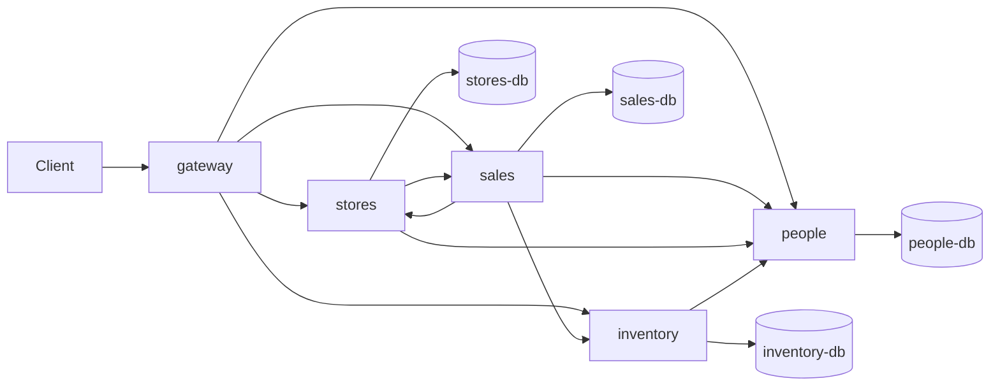

### Use case flows

All calls are synchronous HTTP. The gateway only routes: every contract
endpoint goes to exactly one service, the **leader** of that use case, which
makes all further calls. The checks run in the same order as in the monolith,
so a request that breaks a rule gets the same error.

A use case gets a sequence diagram only when its leader calls another
service. Use cases marked "no diagram" are handled by one service alone: the
gateway passes the request on and the leader answers from its own database.
It may read several of its own tables (for example `orders_ticket` and
`orders` for a purchase order), but it calls no other service. Calls between
services are what the diagrams are for: they add hops and latency, need undo
steps, and fail when the other service is down.

| Use case | Endpoint | Leader | Other services called | Flow |
|----------|----------|--------|-----------------------|------|
| Look up a product | `GET /products/{id}` | inventory | none | no diagram |
| Register a customer | `POST /customers` | people | none | no diagram |
| Look up a customer | `GET /customers/{id}` | people | none | no diagram |
| Issue a gift card | `POST /gift-cards` | sales | none | no diagram |
| Check a gift card balance | `GET /gift-cards/{id}` | sales | none | no diagram |
| Look up a purchase order | `GET /purchase-orders/{id}` | inventory | none | no diagram |
| Checkout | `POST /sales` | sales | stores, people, inventory | [Checkout](#checkout) |
| Look up a sale | `GET /sales/{id}` | sales | stores | [Look up a sale](#look-up-a-sale) |
| Return | `POST /returns` | sales | stores, people, inventory | [Return](#return) |
| Open a register | `POST /registers/{r}/open` | stores | people | [Open a register](#open-a-register) |
| Close a register (Z-report) | `POST /registers/{r}/close` | stores | people, sales | [Close a register](#close-a-register-z-report) |
| Create a purchase order | `POST /purchase-orders` | inventory | people | [Create a purchase order](#create-a-purchase-order) |
| Goods receipt | `POST /purchase-orders/{id}/receipt` | inventory | people | [Goods receipt](#goods-receipt) |
| Sales report | `GET /reports/sales` | sales | stores | [Sales report](#sales-report) |

#### Checkout

Use case: a cashier sells products at an open register, optionally to a
customer, paid with cash, card and/or gift cards. Endpoint `POST /sales`.
The register number in the answer is the one from the request; no extra call
is needed for it.

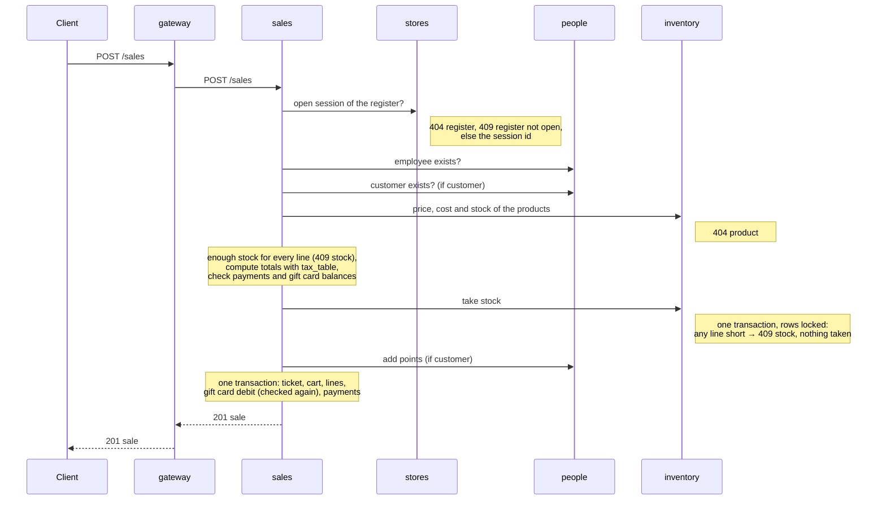

#### Look up a sale

Use case: show a past sale (receipt) with its lines and payments. Endpoint
`GET /sales/{id}`. A sale stores only its register session
(`ticket_system.register_id`); sales asks stores for the register number of
that session on every read.

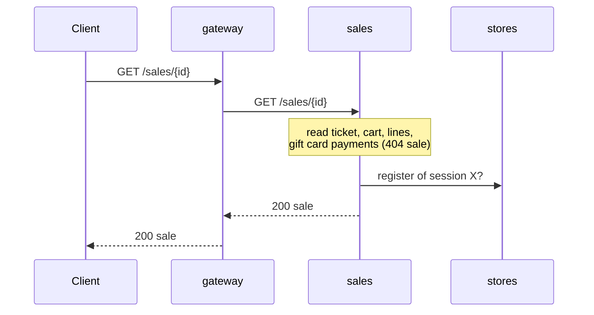

#### Return

Use case: a customer brings back products of an earlier sale at an open
register (not necessarily the register of the sale) and gets a cash refund.
Endpoint `POST /returns`.

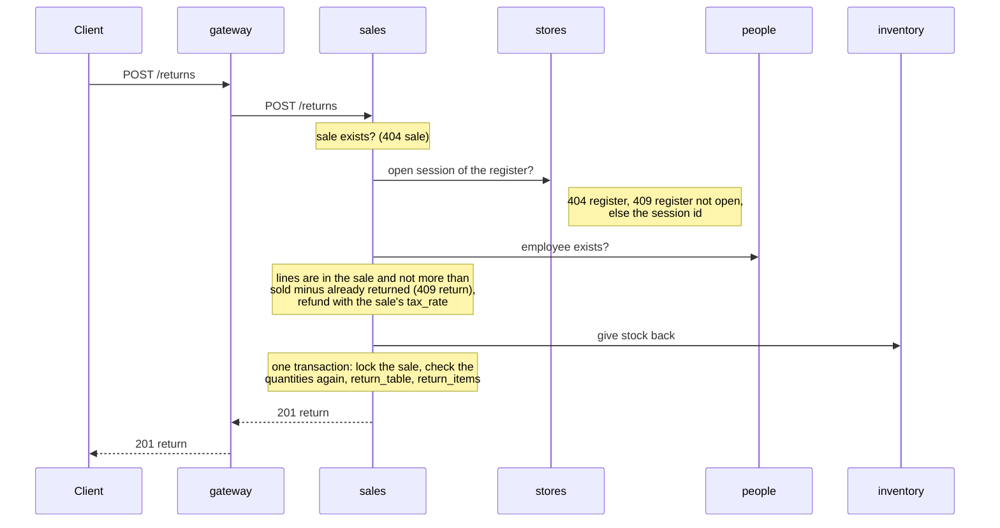

#### Open a register

Use case: an employee opens a register session with a cash float at the
start of a shift. Endpoint `POST /registers/{r}/open`.

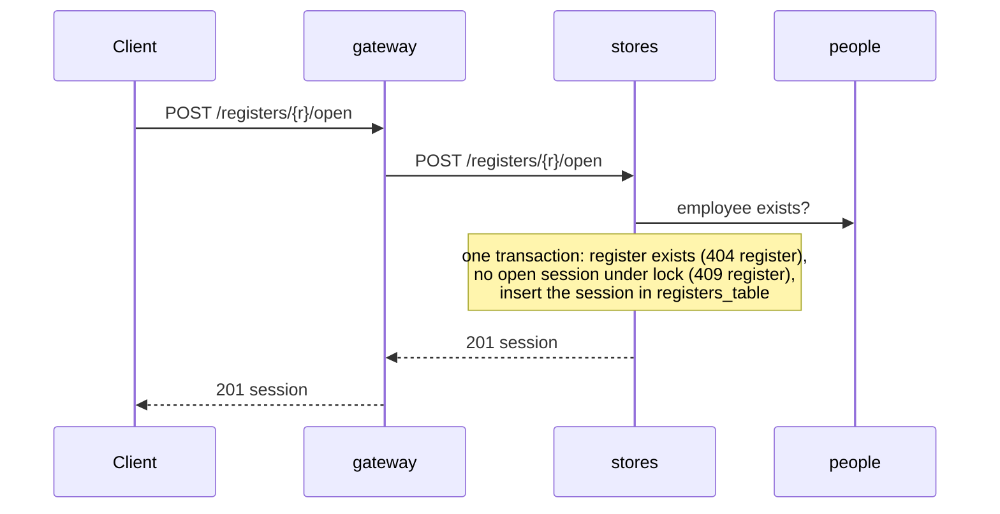

#### Close a register (Z-report)

Use case: an employee closes the register session at the end of a shift,
enters the counted cash and gets the Z-report. Endpoint
`POST /registers/{r}/close`.

Stores closes the session **before** it asks sales for the totals. From that
moment a new sale or return at this register gets `409 register`, so the
totals no longer change. This is an exception to "the leader's own write
comes last"; see "All-or-nothing".

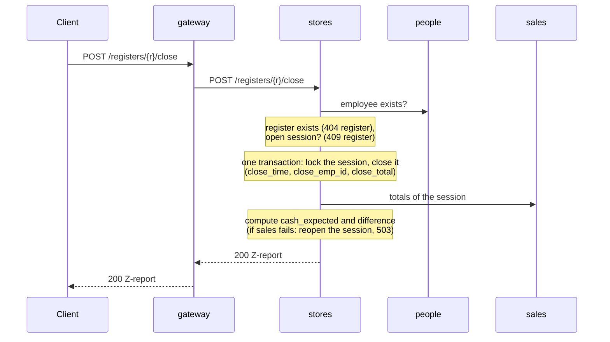

#### Create a purchase order

Use case: an employee orders products from a vendor. Endpoint
`POST /purchase-orders`.

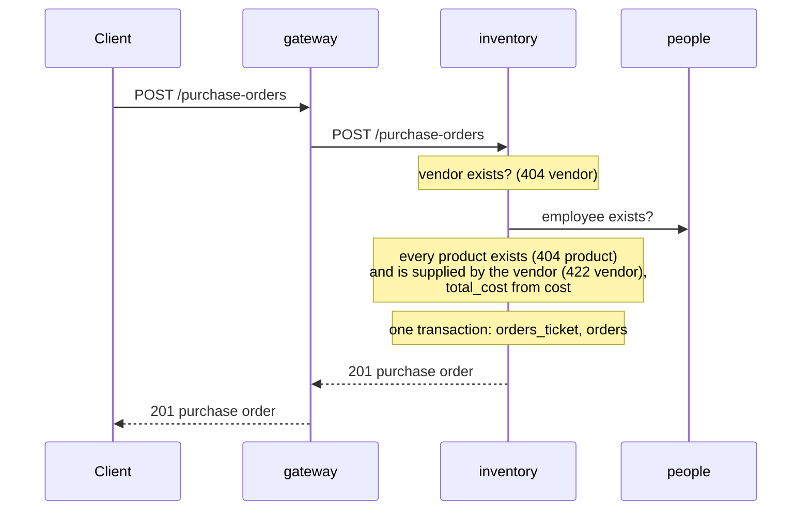

#### Goods receipt

Use case: an employee confirms that an ordered delivery arrived; the ordered
quantities go into stock. Endpoint `POST /purchase-orders/{id}/receipt`.

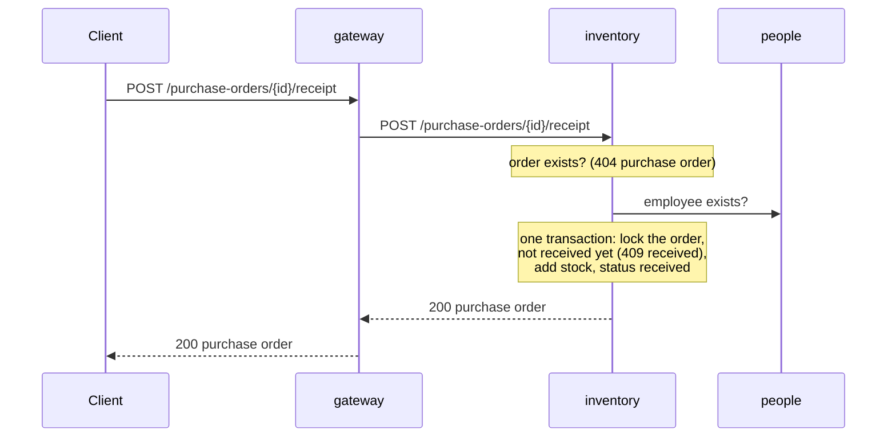

#### Sales report

Use case: the head office sees the sales, refunds and top products of one
store over a date range. Endpoint `GET /reports/sales`. Which register
sessions belong to which store is known only by stores, so sales asks for
them.

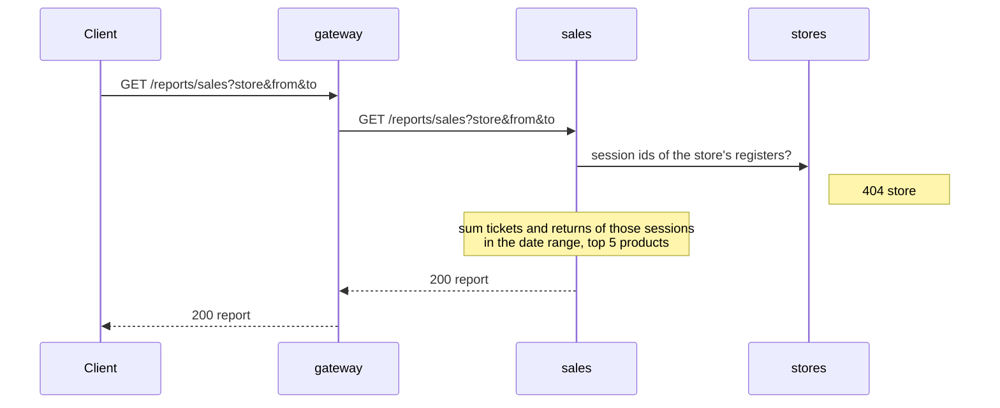

### Service APIs

The contract endpoints are served by their leader (see the use case table).
These are the internal calls between services. They follow "Conventions for
calls between services": the `X-Request-Id` and `X-Step-Key` headers on every
call, errors as `{ "detail" }` passed on unchanged, `503` after 2 s. A call marked with a step
name changes data, writes a receipt in `applied_steps`, and is undone with
`POST /internal/undo` `{ "step": "<step name>" }`. Calls without a step only
read data; they need no receipt and no undo. If such a call fails, the leader
stops and undoes the steps done so far.

**people**

| Call | Request | Answer | Errors | Step | Used by |
|------|---------|--------|--------|------|---------|
| `GET /internal/employees/{id}` | none | `200` `{ employee_id }` | `404 employee not found` | none (read only) | sales, stores, inventory |
| `GET /internal/customers/{id}` | none | `200` `{ customer_id }` | `404 customer not found` | none (read only) | sales |
| `POST /internal/customers/{id}/points` | `{ points }` | `200` `{ customer_id, reward_points }` | `404 customer not found` | `add_points` | sales (checkout) |

The existence checks answer only the ID, so no personal data leaves people.

**inventory**

| Call | Request | Answer | Errors | Step | Used by |
|------|---------|--------|--------|------|---------|
| `GET /internal/products?ids=5,40` | none | `200` `[ { product_id, unit_price, cost, in_stock } ]` | `404 product <id> not found` | none (read only) | sales (checkout) |
| `POST /internal/stock/take` | `{ lines: [ { product_id, qty } ] }` | `200` `{ lines }` | `404 product <id> not found`, `409 not enough stock for product <id>` | `take_stock` | sales (checkout) |
| `POST /internal/stock/give-back` | `{ lines: [ { product_id, qty } ] }` | `200` `{ lines }` | `404 product <id> not found` | `give_stock_back` | sales (return) |

`/internal/stock/take` changes all lines in one transaction with the product
rows locked. Lines with the same product are added up first.

**stores**

| Call | Request | Answer | Errors | Step | Used by |
|------|---------|--------|--------|------|---------|
| `GET /internal/registers/{register}/open-session` | none | `200` `{ session_id, register }` | `404 register not found`, `409 register <r> is not open` | none (read only) | sales (checkout, return) |
| `GET /internal/sessions/{session_id}` | none | `200` `{ session_id, register }` | `404 session not found` | none (read only) | sales (look up a sale) |
| `GET /internal/stores/{SID}/sessions` | none | `200` `{ store, session_ids: [ ... ] }` | `404 store not found` | none (read only) | sales (sales report) |

`session_id` is `registers_table.register_id`; `register` is
`register_num`. `/internal/stores/{SID}/sessions` returns the sessions of all
registers of the store, open and closed.

**sales**

| Call | Request | Answer | Errors | Step | Used by |
|------|---------|--------|--------|------|---------|
| `GET /internal/sessions/{session_id}/totals` | none | `200` `{ session_id, sales_count, gross_total, tax_total, cash_sales, refunds_total }` | none: a session without sales answers zeros | none (read only) | stores (Z-report) |

### All-or-nothing

We follow the shared rule: checks first, then the writes in other services,
then the leader's own transaction. If a step fails, the earlier writes are
undone in reverse order.

- **Checkout:** sales takes stock (inventory), then adds points (people), then
  writes the sale in its own transaction. If taking stock fails or times out,
  sales undoes `take_stock`. If adding points fails or times out, sales undoes
  `add_points` and then `take_stock`. If its own transaction fails, sales
  undoes `add_points` and then `take_stock`. Inventory checks the stock again
  inside `take_stock` (shared rule "check and change in one step"), so two
  sales of the last item never both succeed.
- **Gift cards:** they belong to sales, so the debit is part of the sale's own
  transaction. The balance is checked again there under a row lock, so it
  never goes below zero.
- **Return:** sales adds the stock back (inventory), then writes the return.
  In its own transaction it locks the sale and checks the returned quantities
  again, so two returns of the same sale at the same time never return more
  than was sold. If giving the stock back fails or times out, or this check or
  its own transaction fails, sales undoes `give_stock_back`.
- **Z-report:** stores closes the session in its own transaction first, then
  asks sales for the totals. If that call fails, stores reopens the session
  (clears `close_time`, `close_emp_id`, `close_total`) and answers `503`, so
  nothing has changed. If another session of the register was opened in the
  meantime, it cannot reopen; it logs an error, as for a failed undo.
  Closing first is an exception to "the leader's own write comes last": it
  stops new sales and returns at once, so the totals cannot change while they
  are read.
- **Goods receipt:** stock and order status are both in inventory, so one
  transaction is enough.
- **Receipts:** in this variant only inventory (`take_stock`,
  `give_stock_back`) and people (`add_points`) change data on request of
  another service, so only `inventory-db` and `people-db` get the table
  `applied_steps` (see "Receipts and undo" in the common decisions). An undo
  after a timeout follows the same rule as after an error.

### Failure behaviour

| What fails | What happens | Why this is acceptable or not |
|------------|--------------|-------------------------------|
| people | No sale, return, register open or close, purchase order or receipt (the employee check fails). Customer endpoints fail. | Not acceptable for the store manager: every till stops. This is the cost of one owner per table and no copies. |
| stores | No sale, sale lookup, return, register open or close, or sales report. | Not acceptable for the store manager: sales cannot check the register session. A sale lookup fails too, because the register number of a sale is asked from stores on every read. |
| inventory | No sale, return, product lookup, purchase order or receipt. | Expected: every sale needs prices and stock. |
| sales | No sale, return, gift card, sales report or Z-report. | Expected: sales is the core of the till. |
| a sale or return runs while its register is closed | A sale or return that checked "session open" just before the close, and commits after sales has counted the totals, is missing from the Z-report. It is still stored with that session and counts in the sales report. | Known gap, accepted. It can only hit a sale that is in progress at the moment of the close (between its session check and its commit), because the session is closed before the totals are read. Closing it fully would cost every sale one more call to stores. |
| an undo fails (the owner is down when the undo is sent) | Data stays half done, for example stock taken without a sale. The service logs an error. | Known gap, accepted for this assignment. Rare, because the leader's own transaction comes last. A timeout alone no longer leaves data half done (see "Receipts and undo"). |

---

## Variant B: capability-aligned

The services follow what Frischwerk does, not the legacy tables: selling at
the till, assortment and purchasing, customers and loyalty, and sales
reporting for head office. Four capabilities plus the gateway, the same
number of services as variant A, so that the comparison is fair.

Team fit (Head of Development: two teams, four developers): team "Store"
owns `till`; team "Head office" owns `purchasing`, `customers` and
`reporting`.

Data minimisation (Data Protection Officer): no service of B stores personal
data of employees (names, SSN, address, passwords); the PoS needs only the
employee ID (a "staff ID"). Personal data of customers lives only in
`customers`; every other service keeps only the `customer_id`. Vendors
(suppliers) are companies, not persons.

All decisions common to both variants apply unchanged: synchronous HTTP, no
broker, the leader pattern, "Receipts and undo" with `applied_steps`, the
"Conventions for calls between services", 2 s per call between services,
20 s at the gateway, and no preparation for the change requests in v1.

### Services

| Service | Capability (bounded context) | Owns (its own model) | Copies of data from others (source, how kept current) | Store |
|---------|------------|----------------------|--------------------------------------------------------|-------|
| gateway | routing only: every contract endpoint goes to one leader | none | none | none |
| till | **Selling at the till**: register shifts and the Z-report, sales, returns and refunds, gift cards, stock on hand, the tax rate | shifts, sales, sale lines, payments, returns, return lines, gift cards, stock on hand, tax rates, ledger outbox, `applied_steps` | **price list** `product_id → unit_price` (source: purchasing; initial load from the seed at start, then pulled from `GET purchasing /internal/price-list` every 60 s; if the pull fails, the last copy stays). **Registers of each store** `register → store` (source: store administration, outside the PoS; loaded from the seed at start; no contract use case changes them). **Staff IDs** (source: HR, outside the PoS; loaded from the seed at start; no contract use case changes them) | `till-db` |
| purchasing | **Assortment and purchasing**: product master, suppliers, purchase orders, goods receipt | products (name, brand, description, category, subcategory, retail price, cost, supplier; **not** stock), suppliers, purchase orders, order lines | **Staff IDs** (source: HR; loaded from the seed at start) | `purchasing-db` |
| customers | **Customers and loyalty**: customer profiles, reward points | customers (first and last name, email, phone, street, zip code, city, reward points; no legacy password, no US state), `applied_steps` | none | `customers-db` |
| reporting | **Sales reporting** for head office and finance | the sales ledger: sale entries with their lines, refund entries | **Sale and refund entries** (source: till; delivered by a transactional outbox over HTTP, see "Ledger delivery"). **Store list** (source: store administration; loaded from the seed at start) | `reporting-db` |

### Components

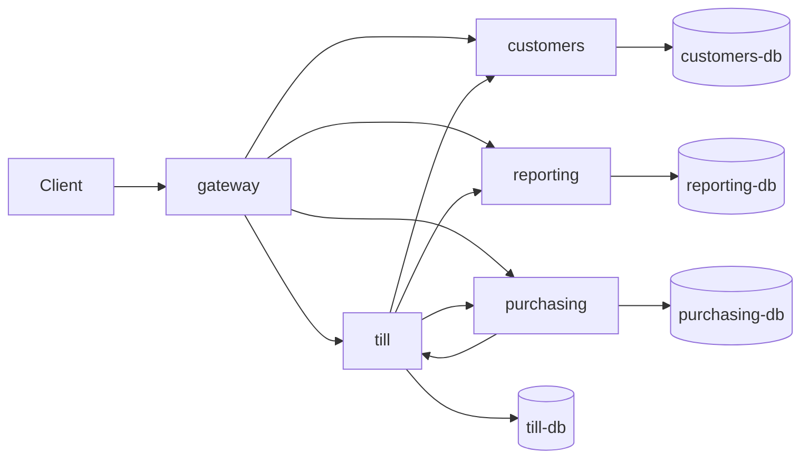

till calls customers (earn points), reporting (ledger entries) and
purchasing (price list). purchasing calls till (stock on hand, receive
stock).

Networks: each store shares a network only with its owner (`till-net`,
`purchasing-net`, `customers-net`, `reporting-net`). The gateway and the four
application services share the network `backend`. Only the gateway publishes
a port (`8000:8000`).

### Use case flows

All calls are synchronous HTTP. The gateway only routes: every contract
endpoint goes to exactly one service, the **leader** of that use case, which
makes all further calls. As in variant A, a use case gets a sequence diagram
only when its leader calls another service.

| Use case | Endpoint | Leader | Other services called | Flow |
|----------|----------|--------|-----------------------|------|
| Look up a product | `GET /products/{id}` | purchasing | till (stock on hand) | [Look up a product](#look-up-a-product) |
| Register a customer | `POST /customers` | customers | none | no diagram |
| Look up a customer | `GET /customers/{id}` | customers | none | no diagram |
| Issue a gift card | `POST /gift-cards` | till | none | no diagram |
| Check a gift card balance | `GET /gift-cards/{id}` | till | none | no diagram |
| Open a register | `POST /registers/{r}/open` | till | none | no diagram |
| Close a register (Z-report) | `POST /registers/{r}/close` | till | none | no diagram, see below |
| Checkout | `POST /sales` | till | customers (only with `customer_id`), reporting (ledger delivery after commit) | [Checkout (B)](#checkout-b) |
| Look up a sale | `GET /sales/{id}` | till | none | no diagram |
| Return | `POST /returns` | till | reporting (ledger delivery after commit) | [Return (B)](#return-b) |
| Create a purchase order | `POST /purchase-orders` | purchasing | none | no diagram |
| Look up a purchase order | `GET /purchase-orders/{id}` | purchasing | none | no diagram |
| Goods receipt | `POST /purchase-orders/{id}/receipt` | purchasing | till (receive stock) | [Goods receipt (B)](#goods-receipt-b) |
| Sales report | `GET /reports/sales` | reporting | none | no diagram, see below |

Background work, not a contract use case: till pulls the price list from
purchasing every 60 s, and till retries undelivered ledger entries every 2 s
(see "Ledger delivery to reporting").

Use cases without a diagram, in detail:

- **Register a customer / look up a customer (customers):** one transaction
  in customers. A new customer has `reward_points` `0`. The answer is the same
  as in the monolith: `{ customer_id, first_name, last_name, email,
  reward_points }`; `404 customer not found`.
- **Issue / check a gift card (till):** one transaction in till;
  `{ gift_card_id, balance }`; `404 gift card not found`.
- **Open a register (till):** one transaction: employee in the staff IDs
  (`404 employee not found`), register exists (`404 register not found`),
  lock the register row `FOR UPDATE`, no open shift of that register
  (`409 register <r> is already open`), insert the shift. Answer
  `{ session_id, register, opened_at }`; `session_id` is the shift ID.
- **Close a register (till):** one transaction: employee
  (`404 employee not found`), register exists (`404 register not found`),
  lock the register row and the open shift row `FOR UPDATE`, no open shift
  → `409 register <r> is not open`. Then, in the same transaction while the
  shift row is locked, compute the Z-report from the shift's sales, payments
  and returns, and close the shift (`closed_at`, `closed_by`,
  `counted_cash`). Every sale and return transaction takes a **shared** lock on
  its shift row and checks again that the shift is open, so a sale either
  commits before the close (and is in the Z-report) or fails with
  `409 register`. The race of variant A ("a sale in progress while the
  register is closed") cannot happen.
- **Look up a sale (till):** local; the sale stores its register number and
  shift. `404 sale not found`.
- **Create a purchase order (purchasing):** one transaction: supplier exists
  (`404 vendor not found`), employee in the staff IDs
  (`404 employee not found`), every product exists (`404 product not found`)
  and is supplied by the vendor (`422 product 
 is not supplied by vendor
  <v>`), `total_cost` = sum of `qty × cost`. Status `open`.
- **Look up a purchase order (purchasing):** local; `404 purchase order not
  found`.
- **Sales report (reporting):** local from the ledger: store exists
  (`404 store not found`); sale entries and refund entries of the store with
  a date in the range (both inclusive); `sales_count`, `gross_total` (sum of
  `total`), `tax_total` (sum of `tax`), `refunds_total`,
  `net_revenue = gross_total - refunds_total`; `top_products`: at most five
  products by quantity sold (sum of the sale entry lines, not reduced by
  returns), highest first, ties by the lower `product_id`, as in the monolith.

#### Look up a product

Use case: show a product with its price, cost and stock. Endpoint
`GET /products/{id}`. The product master is in purchasing, stock on hand is in
till.

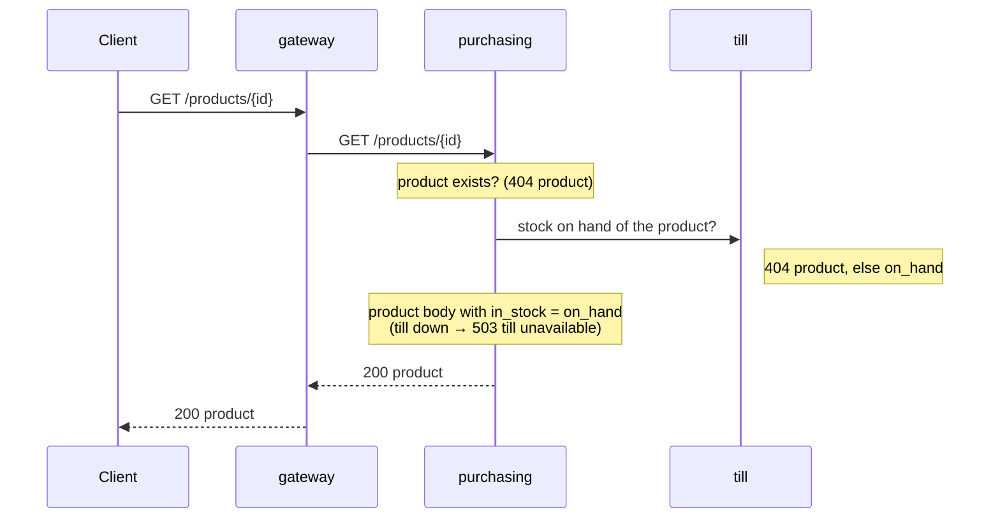

#### Checkout (B)

Use case: a cashier sells products at an open register, optionally to a
customer, paid with cash, card and/or gift cards. Endpoint `POST /sales`.
Everything except the reward points is till's own data, so the sale itself is
one local transaction: no saga for stock or gift cards.

Checks, in this order, read without locks:

1. register exists (`404 register not found`), it has an open shift
   (`409 register <r> is not open`);
2. employee in the staff IDs (`404 employee not found`);
3. every product in the price list (`404 product not found`);
4. enough stock per product, lines of one product added up
   (`409 not enough stock for product 
`);
5. totals: `line_total = qty × unit_price`, `subtotal` = sum,
   `tax = subtotal × rate` (rate of the latest tax year), `total = subtotal +
   tax`, each rounded half up to 0.01 as in the monolith;
6. payments add up to `total` (`422 payments add up to …, but the total is
   …`);
7. every gift card payment has a `gift_card_id` (`422`), the card exists
   (`404 gift card not found`) and its balance covers the sum of all payments
   with that card (`409 gift card <g> balance too low`).

The customer is checked last, by the `earn` call. This differs from
the monolith only when several rules are broken at once (an unknown customer
together with, for example, a payment error gives the payment error).

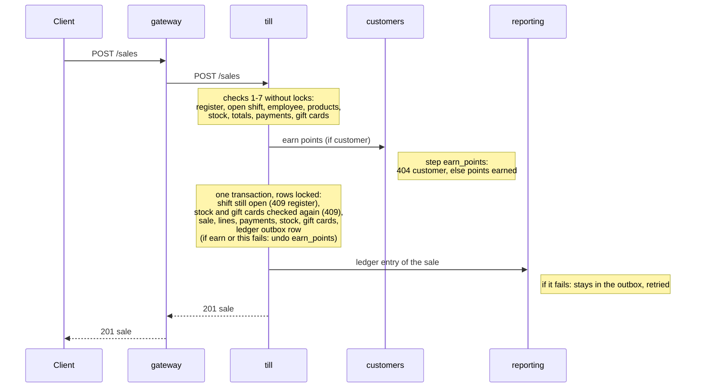

#### Return (B)

Use case: a customer brings back products of an earlier sale at an open
register (not necessarily the register of the sale) and gets a cash refund.
Endpoint `POST /returns`. Sale, stock and shift are all in till.

Checks, in this order: sale exists (`404 sale not found`); register exists
(`404 register not found`) and has an open shift (`409 register <r> is not
open`); employee in the staff IDs (`404 employee not found`); every line is a
product of the sale (`409 product 
 is not part of sale <s>, cannot return
it`) and not more than sold minus already returned (`409 cannot return more
of product 
 than was sold`). `refund_amount = money(net) + money(net ×
rate of the sale)`, where `net` = sum of `qty × unit_price` from the sale, as
in the monolith.

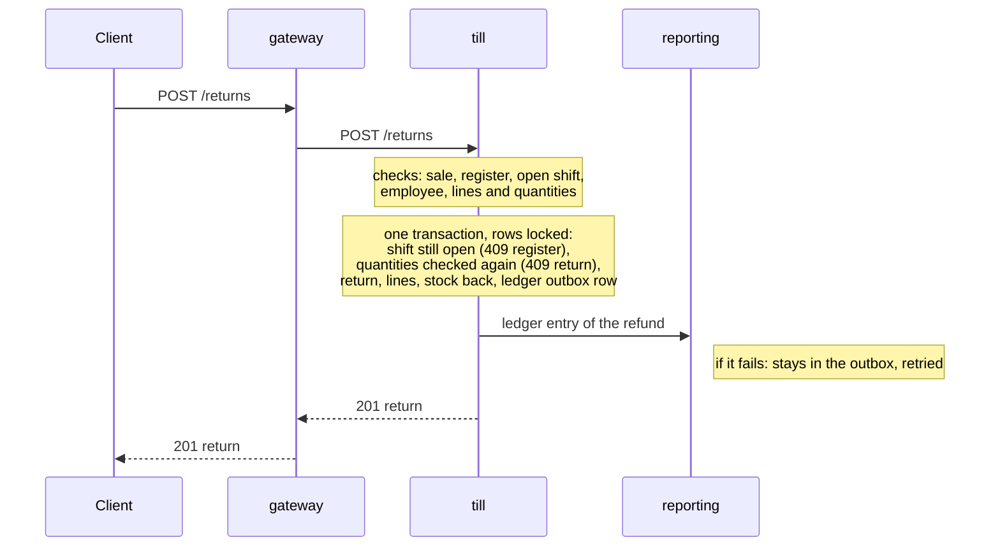

The refund entry carries the store of the **return's** register, as the
contract says.

#### Goods receipt (B)

Use case: an employee confirms that an ordered delivery arrived; the ordered
quantities go into stock. Endpoint `POST /purchase-orders/{id}/receipt`. The
order is purchasing's, stock on hand is till's: this is the one use case where
purchasing writes into till.

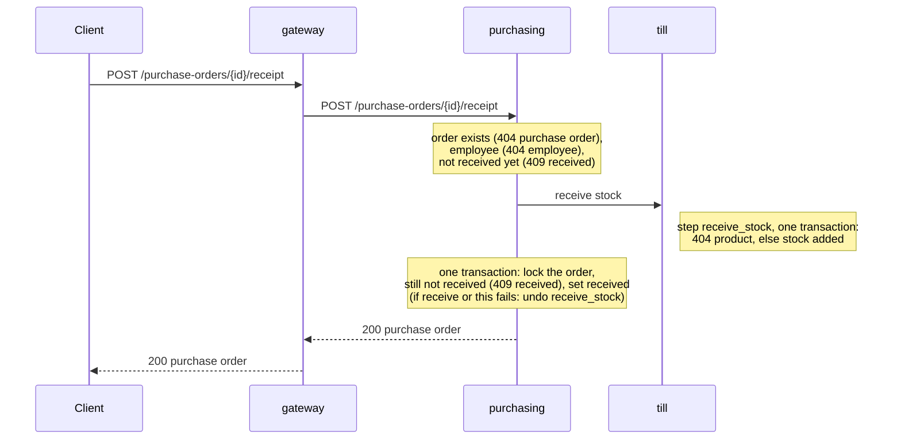

#### Price list refresh and ledger retry (background)

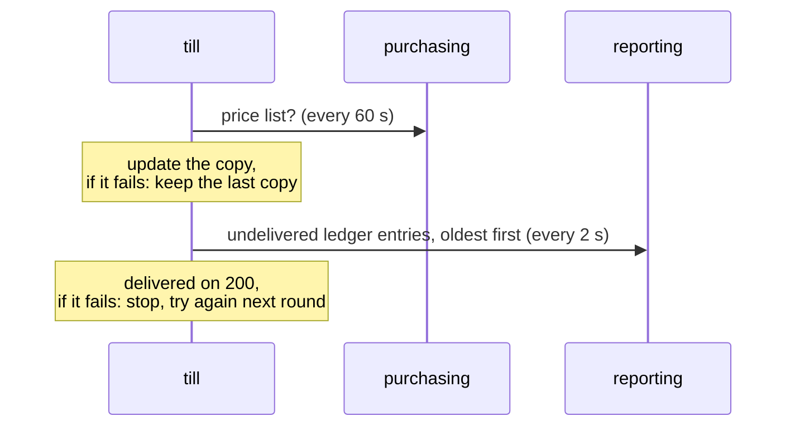

### Service APIs

The contract endpoints are served by their leader (see the use case table).
These are the internal calls between services. They follow "Conventions for
calls between services": the `X-Request-Id` and `X-Step-Key` headers on every
call, errors as `{ "detail" }` passed on unchanged, `503 "<service> unavailable"` after 2 s or
when the service cannot be reached. A call marked with a step name changes
data, writes a receipt in `applied_steps`, and is undone with
`POST /internal/undo` `{ "step": "<step name>" }`.

**till**

| Call | Request | Answer | Errors | Step | Used by |
|------|---------|--------|--------|------|---------|
| `GET /internal/stock/{product_id}` | none | `200` `{ product_id, on_hand }` | `404 product not found` | none (read only) | purchasing (look up a product) |
| `POST /internal/stock/receive` | `{ lines: [ { product_id, qty } ] }` | `200` `{ lines }` | `404 product not found` | `receive_stock` | purchasing (goods receipt) |
| `POST /internal/undo` | `{ step }` | `200` | none | shared | purchasing |

`/internal/stock/receive` adds up lines of one product, checks that every
product exists in the stock table, and adds all lines in one transaction with
the receipt; the receipt's `changes` are the added lines, the undo subtracts
them.

**customers**

| Call | Request | Answer | Errors | Step | Used by |
|------|---------|--------|--------|------|---------|
| `POST /internal/customers/{id}/earn` | `{ total }` | `200` `{ customer_id, points_earned, reward_points }` | `404 customer not found` | `earn_points` | till (checkout) |
| `POST /internal/undo` | `{ step }` | `200` | none | shared | till |

The loyalty rule belongs to the loyalty context, so it lives here:
`points_earned = floor(total)`. The receipt's `changes` are
`{ customer_id, points }`; the undo subtracts exactly these points. The call
answers no personal data.

**reporting**

| Call | Request | Answer | Errors | Step | Used by |
|------|---------|--------|--------|------|---------|
| `POST /internal/ledger/sales` | `{ sale_id, store, date, total, tax, lines: [ { product_id, qty } ] }` | `200` `{ sale_id }` | none | none (idempotent by `sale_id`) | till (after a checkout, and the outbox retry) |
| `POST /internal/ledger/refunds` | `{ return_id, sale_id, store, date, refund_amount }` | `200` `{ return_id }` | none | none (idempotent by `return_id`) | till (after a return, and the outbox retry) |

A repeated delivery of the same `sale_id` or `return_id` answers as before
without writing again (idempotent). The entries are keyed on the business ID,
not on `X-Request-Id`: the client chooses that ID and may send the same one
for two different sales (see `ai-log/findings.md`, B1). Ledger entries are
never undone, so reporting keeps no receipts and has no `/internal/undo`.

**purchasing**

| Call | Request | Answer | Errors | Step | Used by |
|------|---------|--------|--------|------|---------|
| `GET /internal/price-list` | none | `200` `[ { product_id, unit_price } ]` | none | none (read only) | till (refresh every 60 s) |

`applied_steps` exists in `till-db` and `customers-db`: the services whose
changes on request of another service can be undone.

### Ledger delivery to reporting

A transactional outbox over HTTP, without a broker:

- The outbox row is written in the **same transaction** as the sale or the
  return, together with the request's `X-Request-Id`. Payload for a sale:
  `{ sale_id, store, date, total, tax, lines: [ { product_id, qty } ] }`; for a
  return: `{ return_id, sale_id, store, date, refund_amount }`. `store` is the
  store of the register of the sale or return; `date` is its date in
  Europe/Zurich.
- Right after the commit, till posts the row to
  `POST reporting /internal/ledger/sales` or
  `/internal/ledger/refunds`, with a 2 s timeout and the
  original `X-Request-Id`, and marks it delivered on `200`. A failure never
  fails the sale or return: the client still gets its `201`.
- A background task in till sends the undelivered rows every 2 s, oldest
  first, with their original `X-Request-Id`; it stops at the first failure and
  tries again in the next round. If a row is delivered twice, the second
  delivery changes nothing (idempotent by `sale_id` / `return_id`).
- Reporting inserts an entry only if no entry with that `sale_id` or
  `return_id` exists (`INSERT IGNORE` on the primary key), so a repeated
  delivery answers as before and changes nothing.
- Ledger entries are never undone: they are only sent after the sale or
  return is final.
- The number of undelivered rows in the outbox is the visible size of the gap
  while reporting is down.

### Language

Inside every service the names follow the business. The gateway and the
contract keep the contract names (`sale_id`, `session_id`, `register`,
`vendor_id`, …); each service maps them at its edge.

| Legacy name | Name in this variant | Service |
|-------------|----------------------|---------|
| `registers_table` (register session) | shift (`shifts`; `session_id` in the contract = shift ID) | till |
| `store_registers` | register of a store (`registers`) | till |
| `ticket_system` | sale (`sales`) | till |
| `item_list` | sale line (`sale_lines`) | till |
| `cart_inprogress` | dropped: a sale has its lines | – |
| `ticket_system.cash`, `.credit`, `ticket_gift_payment` | payment with a tender: cash, card, gift card (`payments`) | till |
| `return_table`, `return_items` | return, return line, refund (`returns`, `return_lines`) | till |
| `gift_card` | gift card (`gift_cards`) | till |
| `tax_table` | tax rate (`tax_rates`) | till |
| `product_inventory.in_stock` | stock on hand (`stock`) | till |
| `product_inventory.unit_price` | price list entry (`price_list`, a copy) | till |
| `product_inventory` (rest) | product (`products`), retail price, cost | purchasing |
| `vendorinfo` | supplier (`suppliers`; `vendor_id` in the contract) | purchasing |
| `orders_ticket`, `orders` | purchase order, order line, goods receipt (`purchase_orders`, `order_lines`) | purchasing |
| `customer_info` | customer and points account (`customers`, `reward_points`) | customers |
| `employee_info` | staff member, ID only (`staff`) | till, purchasing |
| `stores` | store (`stores`, ID only) | reporting |
| – (new) | ledger entry: sale entry, refund entry (`sale_entries`, `sale_entry_lines`, `refund_entries`) | reporting |

Money columns are `DECIMAL(12,2)`; rates are `DECIMAL(6,4)`. Phone numbers
and zip codes are strings in customers.

### Copies

| Copy | Kept in | Source | How it is kept current | How stale it can be |
|------|---------|--------|------------------------|---------------------|
| price list (`product_id → unit_price`) | till | purchasing | loaded from the seed at start; pulled from `GET /internal/price-list` every 60 s (upsert); a failed pull keeps the last copy | up to 60 s, longer while purchasing is down. No contract use case changes a price, so in this assignment it never differs. |
| registers of each store | till | store administration (outside the PoS) | loaded from the seed at start | never changes in the contract |
| staff IDs | till, purchasing | HR (outside the PoS) | loaded from the seed at start | never changes in the contract |
| store list | reporting | store administration (outside the PoS) | loaded from the seed at start | never changes in the contract |
| sale entries, refund entries | reporting | till | transactional outbox, delivered right after the commit and retried every 2 s | normally none: delivered before the `201` is sent; while reporting is down, until it is back (a few seconds after) |

### All-or-nothing

We follow the shared rule: checks first, then the writes in other services,
then the leader's own transaction. If a step fails, the earlier writes are
undone in reverse order.

- **Checkout:** the only write in another service is `earn_points` in
  customers, and only with a customer. Till writes the sale in its own
  transaction afterwards. If `earn_points` fails or times out, till undoes
  `earn_points` and answers the error. If the re-check or the transaction
  fails, till undoes `earn_points` and answers the error. Stock and gift cards
  are till's, so they are checked again and changed in the same transaction
  with the rows locked `FOR UPDATE` (shared rule "check and change in one
  step"): two sales of the last item never both succeed, a gift card never
  goes below zero. Rows are locked in a fixed order (shift, then products by
  ID, then gift cards by ID) so that two sales cannot deadlock.
- **Ledger delivery** comes after the commit and is not part of the
  all-or-nothing: the sale is final, the entry is delivered sooner or later
  (see "Ledger delivery to reporting").
- **Return:** one transaction in till (shift shared lock, sale `FOR UPDATE`,
  quantities checked again, return, stock back, outbox row). No other service
  is written before it, so there is nothing to undo.
- **Open / close / Z-report:** one transaction in till each; see the use case
  details above.
- **Goods receipt:** purchasing calls `receive_stock` in till, then sets the
  order received in its own transaction with the order row locked and checks
  again that it is not received. If `receive_stock` fails or times out, or the
  re-check or the transaction fails, purchasing undoes `receive_stock`. Two
  receipts of the same order at the same time: both add stock, one wins the
  lock, the other undoes its `receive_stock` and answers `409 received`.
- **Receipts:** `applied_steps` in `till-db` (`receive_stock`),
  `customers-db` (`earn_points`), following "Receipts and undo" in the common decisions. An
  undo after a timeout follows the same rule as after an error.

### Failure behaviour

| What fails | What happens | Why this is acceptable or not |
|------------|--------------|-------------------------------|
| till or `till-db` | No sale, sale lookup, return, gift card, register open or close, Z-report. Product lookup (no stock) and goods receipt fail too. Purchase orders, customers and the sales report keep working. | Expected: till is the selling capability. It is the only container pair that every checkout needs. |
| customers or `customers-db` | A sale **with** a customer fails (`503`); sales without a customer, returns, register open and close keep working. Customer endpoints fail. | Acceptable: the cashier completes the sale without the loyalty card. |
| purchasing or `purchasing-db` | Checkout, returns, Z-report and sales report keep working (till uses its copy of the price list). Product lookup, purchase orders and goods receipt fail. | Acceptable: back office. |
| reporting or `reporting-db` | Checkout and returns keep working; the ledger entries wait in till's outbox. The sales report fails. When reporting is back, the outbox delivers within a few seconds. | Acceptable for the store manager. Head of Finance: the report lags only during the outage, and the gap is visible as undelivered outbox rows. |
| a sale or return runs while its register is closed | Cannot happen: the close locks the shift row, every sale and return takes a shared lock on it and checks again that the shift is open. | – |
| an undo fails (the owner is down when the undo is sent) | As in variant A: the leader logs an error, and the data may stay half done (for example points earned for a sale that does not exist, or stock received for an order that is still open). | Known gap, accepted for this assignment, same as A. A timeout alone does not leave data half done (see "Receipts and undo"). |

### Why this cut

Granularity drivers (Ford et al., *Software Architecture: The Hard Parts*,
ch. 7): disintegrators pull a service apart, integrators pull it together.

- **till merges** selling, returns, register shifts, gift cards and stock on
  hand. Integrators: **database transactions** (a sale reduces stock, debits
  gift cards and must belong to an open shift, atomically; a return checks the
  sale's lines; the Z-report must cover exactly the shift's sales) and
  **workflow** (every checkout needs all of them). Result: checkout is one
  local transaction, no saga for stock or gift cards, and the race of variant
  A "sale in progress while the register is closed" cannot happen.
- **purchasing is split off.** Disintegrators: **fault tolerance** (store
  manager: checkout must work when the back office is down; till keeps its own
  price list) and a different **rate of change** and team (head office).
  Products, suppliers and orders stay together (integrator: **data
  relationships**, "every product must be supplied by the order's vendor").
- **customers is split off.** Disintegrators: **security** (personal data in
  one place, with its own access control) and **volatility** (the loyalty
  programme on the roadmap lands in one context).
- **reporting is split off.** Disintegrators: **fault tolerance** and
  **scalability** (report queries never load till's database; checkout works
  when reporting is down), and its own model for finance (a ledger).
- **Price of the cut:** a product lookup needs two services; goods receipt
  writes into till; the report reads a copy that lags while reporting is down;
  a sale with a customer needs customers.

---

## Decisions taken by the agent

Decisions the design left open, taken while implementing. Please review.

### Both variants

- **Receipt row first.** A step writes its `applied_steps` row (`done`, no
  changes yet) as the first statement of its transaction and fills in
  `changes` at the end. If the row already exists, the step reads it: `done`
  answers as before, `undone` answers `409 step <step> of this request was
  cancelled`. An undo likewise tries to insert an `undone` row first and only
  reads the existing row on a duplicate key. Reason: a locking read of a
  missing row takes a gap lock in InnoDB, and a step and its undo arriving at
  the same moment would deadlock; inserting first makes one of them wait for
  the other instead.
- **Undo of an unknown step name** answers `422`. If the undo transaction
  deadlocks three times in a row it answers `500` (the design says an undo
  always answers `200`; this only covers a database failure).
- **Gateway:** a path whose first segment belongs to no use case answers
  `404 not found`. If the leader does not answer within 20 s, the gateway
  answers `503 "<leader> unavailable"`, the same as when it cannot connect.
- **Unexpected errors** in any service answer `500 {"detail": "internal
  error"}` and are still written to the call log.
- **Call log:** an outgoing call that times out or cannot connect is logged
  with `status` `503`. `path` is logged without the query string.

### Variant A

- **Gift card balance** is checked against the sum of all payments with that
  card (contract: "several payments with the same card count together"),
  both in the early check and again under the row lock. The monolith checks
  each payment on its own.
- **Open and close of a register** lock the `store_registers` row
  `FOR UPDATE`, so that two opens (or an open and a close) of one register run
  one after the other.
- **Indexes** were added to legacy tables where the services look rows up by
  a column other than the primary key (`registers_table.register_num`,
  `ticket_system.register_id`, `cart_inprogress.ticket_id`, `item_list.CID`,
  `ticket_gift_payment.ticket_id`, `return_table.ticket_id` and
  `.register_id`, `return_items.RTID`). Table and column names are unchanged.
- **Reward points:** with a customer, `add_points` is called even when
  `floor(total)` is `0`.

### Variant B

- **Isolation level in till.** till's database sessions run with
  `READ COMMITTED` (compose variable `DB_ISOLATION`, read in `common/db.py`).
  Under MariaDB's default `REPEATABLE READ`, the close transaction could
  compute the Z-report from a snapshot taken before it got the shift lock and
  miss a sale that committed while it waited; the same holds for the
  re-checks of a return. `READ COMMITTED` makes every read after a lock see
  all committed rows.
- **Outbox retry** sends only undelivered rows older than one round (2 s), so
  that it does not race the delivery right after the commit and add hops to
  a request that is still running.
- **Price list copy:** the first pull from purchasing happens 60 s after
  start; until then till uses the copy loaded from the seed.
- **Payments in a sale body** are listed as they were paid, one entry per
  payment in the order of the request (the monolith lists one cash and one
  card entry, then the gift cards).
- **Stock:** a product in the price list without a row in `stock` counts as
  0 on hand (`409 stock`).
- **Gift card balance** is checked against the sum of all payments with that
  card, before and again under the row lock; the debit is one update per
  card.
- **Customers:** `zip_code` is accepted as a number or a string and stored
  as a string; `phone` is stored as given. From the seed, the legacy phone
  number (a double) is stored as its digits.
- ~~**Undo in reporting** deletes the entry of the step.~~ Removed in review
  (`ai-log/findings.md`, B1): reporting keys ledger entries on `sale_id` /
  `return_id` and has no receipts and no undo.
