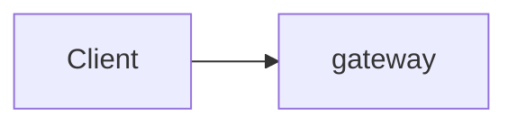
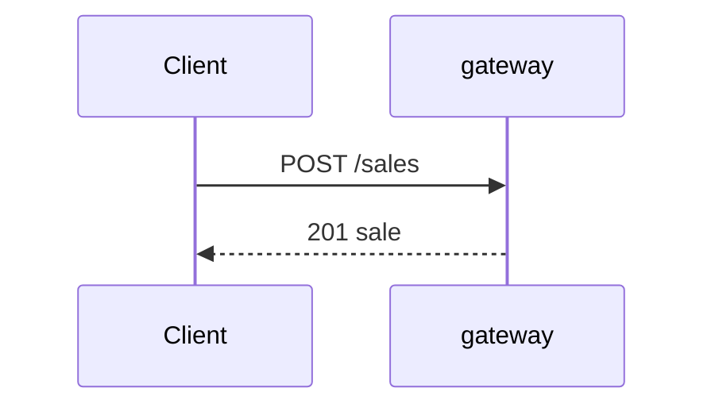

# Design

> This is the specification you give the coding agent, one section per
> variant. Be precise: what you leave open, the agent decides for you.
> The rules of each variant are in `variant-a/README.md` and
> `variant-b/README.md`; the external behaviour is in `contract.md`.
> Delete the quoted guidance when you are done.

## Decisions common to both variants

> For example: technology per service, how services talk to each other
> (HTTP, messages), how a request that spans services stays all-or-nothing,
> how the call log is written, how the seed data is loaded.

| Decision | Choice | Reason |
|----------|--------|--------|
| Technology | Python 3.12 with FastAPI in every service. One MariaDB 11.4 container per service that owns data. | Same as the monolith. The same stack in both variants keeps the comparison fair. |
| How services talk | Synchronous HTTP with JSON. No message broker. | The tests read the result right after a write, so every change must be done when the request returns. Fewer containers. |
| All-or-nothing | The service that owns the main record of a use case leads it. It does all reads and checks first, then the writes in other services, then its own write last. If a step fails, it undoes the earlier writes in reverse order. A service that does not answer within 2 s counts as failed (`503`). | Without one shared database, this is the simplest way to leave nothing half done. The leader's own write comes last because it is the least likely to fail. |
| Call log | Shared code in `common/` in the variant folder. It logs every incoming request and outgoing call to `/logs/<service>.jsonl` and passes `X-Request-Id` on. | One implementation, the same in every service. |
| Seed data | Each service reads `/shared/seed.json` at start and loads only its own data. | Contract. No seed data in the code. |

### Policy for the change requests

> Do you prepare the design for CR1 and CR2 before `v1`? What exactly, and
> why? The same policy applies to both variants.

We do **not** prepare for CR1 and CR2 in v1. Version 1 implements only the
contract as it is: no extra tables, columns, fields or endpoints for VAT or
loyalty tiers.

Reason: we want `make impact` to show how far each cut lets a change spread.
Preparing would hide that and make v1 more complex. The service cuts were
chosen knowing the roadmap; that cannot be avoided and is the same for both
variants.

---

## Variant A: data-aligned

### Services

| Service | Responsibility | Owns (legacy tables) | Store |
|---------|----------------|----------------------|-------|
| gateway | routing, composition | none | none |
| | | | |

### Components

### Use case flows

> For each use case: which services take part, in which order, synchronous
> or asynchronous. At least checkout and the Z-report as sequence diagrams.

### All-or-nothing

> A failed request changes nothing (contract). How do you guarantee this when
> a sale touches stock, gift cards and points in different services?

### Failure behaviour

| What fails | What happens | Why this is acceptable or not |
|------------|--------------|-------------------------------|
| | | |

---

## Variant B: capability-aligned

### Services

| Service | Capability | Owns (its own model) | Copies of data from others (source, how kept current) | Store |
|---------|------------|----------------------|--------------------------------------------------------|-------|
| gateway | routing, composition | none | none | none |
| | | | | |

### Components

### Use case flows

### Language

| Legacy name | Name in this variant | Service |
|-------------|----------------------|---------|
| ticket_system | | |
| | | |

### All-or-nothing

### Failure behaviour

| What fails | What happens | Why this is acceptable or not |
|------------|--------------|-------------------------------|
| | | |
