# Design

> This is the specification you give the coding agent, one section per
> variant. Be precise: what you leave open, the agent decides for you.
> The rules of each variant are in `variant-a/README.md` and
> `variant-b/README.md`; the external behaviour is in `contract.md`.
> Delete the quoted guidance when you are done.

## Decisions common to both variants

| Decision | Choice | Reason |
|----------|--------|--------|
| Technology | Python 3.12 with FastAPI in every service. One MariaDB 11.4 container per service that owns data. | Same as the monolith. The same stack in both variants keeps the comparison fair. |
| How services talk | Synchronous HTTP with JSON. No message broker. | The tests read the result right after a write, so every change must be done when the request returns. Fewer containers. |
| All-or-nothing | The service that owns the main record of a use case leads it. It does all reads and checks first, then the writes in other services, then its own write last. If a step fails, it undoes the earlier writes in reverse order. A service that does not answer within 2 s counts as failed (`503`); the gateway waits up to 20 s for the leader. | Without one shared database, this is the simplest way to leave nothing half done. The leader's own write comes last because it is the least likely to fail. |
| Undo after a timeout | A service that changes its data on request of another service keeps a receipt of every such change in its own database, in the same transaction. After an error **or a timeout**, the leader also sends the undo for that step. See "Receipts and undo" below. | After a timeout the leader cannot tell whether the change happened. The owner can, from its receipt, so the undo always leaves the data right. |
| Check and change in one step | A service that owns a value which must not break a rule (stock never below 0, a balance never below 0) checks the rule and changes the value in one transaction with the rows locked. Another service may read the value first, for an early and clear error, but the check at the owner is the one that counts. | A value read by another service can be out of date a moment later. Two tills selling the last item at the same time must not both succeed. |
| Calls between services | See "Conventions for calls between services" below. | The agent should not have to guess paths, bodies or errors. |
| Call log | Shared code in `common/` in the variant folder. It logs every incoming request and outgoing call to `/logs/<service>.jsonl` and passes `X-Request-Id` on. | One implementation, the same in every service. |
| Seed data | Each service reads `/shared/seed.json` at start and loads only its own data. | Contract. No seed data in the code. |

### Receipts and undo

The problem: the leader asks another service to change data (for example
take stock). The change is committed, but the answer arrives too late, so
the leader counts the step as failed and cancels the request. Under the plain
rule "undo the earlier writes" this step would never be undone: stock would
stay taken for a sale that does not exist.

The rule, the same in both variants, implemented once in `common/`:

- Every service that changes its data on request of another service has the
  table `applied_steps` in its own database:

  | Column | Meaning |
  |--------|---------|
  | `request_id` | the `X-Request-Id` of the request |
  | `step` | name of the change, for example `take_stock`, `add_points` |
  | `status` | `done` or `undone` |
  | `changes` | JSON: what was changed, for example `[{"product_id": 5, "qty": 2}]` |
  | `created_at` | time of the row |

  The primary key is (`request_id`, `step`), so a step and its undo can never
  both go through.
- **Doing a step:** the change and a row with `done` are written in one
  transaction. If a row already exists: `done` means the step was already
  done, so answer as before without changing anything again; `undone` means
  the request was already cancelled, so refuse and change nothing.
- **Undoing a step:** one transaction. A row with `done`: reverse exactly the
  `changes` and set `undone`. A row with `undone`: nothing to do. No row: the
  step has not arrived yet or never will; write a row with `undone` so that a
  late arrival is refused. An undo always answers `200`.
- **The leader:** if a call that changes data fails or times out, it sends the
  undo for that step as well, and then for the earlier steps in reverse
  order.
- Rows are only needed while a request is running. They may be deleted after
  one day; this assignment needs no cleanup job.
- `applied_steps` is not data from another service: it records the service's
  own changes. `request_id` is an ID, not a copy. It is not preparation for
  the change requests either.

### Conventions for calls between services

- The gateway passes every contract request unchanged, on the same method and
  path, to the leader of the use case (see the use case table of the
  variant), and passes its answer back unchanged.
- Calls between services use paths that start with `/internal/`. Only the
  gateway calls the contract paths. Each variant lists its internal calls in
  "Service APIs".
- Bodies are JSON. Amounts are numbers with two decimals, as in the contract.
  Money is computed with `Decimal` and rounded half up to 0.01, as in the
  monolith.
- Errors are `{ "detail": "<text>" }` with the status and keyword from the
  contract, for example `404` `"employee not found"`. When the leader gets
  such an error from another service, it passes the status and `detail` on
  unchanged.
- Every call carries the `X-Request-Id` of the request.
- A call between services that does not answer within 2 s, or cannot
  connect, fails with `503` `"<service> unavailable"`.
- The gateway waits up to **20 s** for the leader, longer than a leader can
  need in the worst case (checkout: 6 calls and 2 undos of 2 s each, 16 s).
  So the client always gets the leader's real answer: the gateway never
  reports a failure for a request that the leader still completes. If the
  leader cannot be reached, the gateway answers `503` at once.
- Every service that changes data on request of another service has
  `POST /internal/undo` with the body `{ "step": "<step name>" }`. It undoes
  that step of the request in `X-Request-Id`, following "Receipts and undo".
  It is the same code in every service, in `common/`.

### Policy for the change requests

We do **not** prepare for CR1 and CR2 in v1. Version 1 implements only the
contract as it is: no extra tables, columns, fields or endpoints for VAT or
loyalty tiers.

Reason: we want `make impact` to show how far each cut lets a change spread.
Preparing would hide that and make v1 more complex. The service cuts were
chosen knowing the roadmap; that cannot be avoided and is the same for both
variants.

---

## Variant A: data-aligned

### Services

| Service | Responsibility | Owns (legacy tables) | Store |
|---------|----------------|----------------------|-------|
| gateway | routing only: every contract endpoint goes to one leader | none | none |
| people | customers and employees | `customer_info`, `employee_info` | `people-db` |
| stores | stores, registers, register sessions, Z-report | `stores`, `store_registers`, `registers_table` | `stores-db` |
| inventory | products, stock, vendors, purchase orders | `product_inventory`, `vendorinfo`, `orders_ticket`, `orders` | `inventory-db` |
| sales | sales, returns, gift cards, tax rate, sales report | `ticket_system`, `cart_inprogress`, `item_list`, `ticket_gift_payment`, `return_table`, `return_items`, `gift_card`, `tax_table` | `sales-db` |

### Components

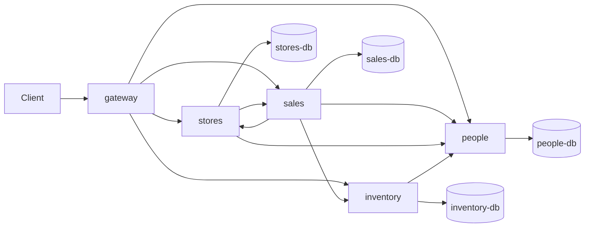

### Use case flows

All calls are synchronous HTTP. The gateway only routes: every contract
endpoint goes to exactly one service, the **leader** of that use case, which
makes all further calls. The checks run in the same order as in the monolith,
so a request that breaks a rule gets the same error.

A use case gets a sequence diagram only when its leader calls another
service. Use cases marked "no diagram" are handled by one service alone: the
gateway passes the request on and the leader answers from its own database.
It may read several of its own tables (for example `orders_ticket` and
`orders` for a purchase order), but it calls no other service. Calls between
services are what the diagrams are for: they add hops and latency, need undo
steps, and fail when the other service is down.

| Use case | Endpoint | Leader | Other services called | Flow |
|----------|----------|--------|-----------------------|------|
| Look up a product | `GET /products/{id}` | inventory | none | no diagram |
| Register a customer | `POST /customers` | people | none | no diagram |
| Look up a customer | `GET /customers/{id}` | people | none | no diagram |
| Issue a gift card | `POST /gift-cards` | sales | none | no diagram |
| Check a gift card balance | `GET /gift-cards/{id}` | sales | none | no diagram |
| Look up a purchase order | `GET /purchase-orders/{id}` | inventory | none | no diagram |
| Checkout | `POST /sales` | sales | stores, people, inventory | [Checkout](#checkout) |
| Look up a sale | `GET /sales/{id}` | sales | stores | [Look up a sale](#look-up-a-sale) |
| Return | `POST /returns` | sales | stores, people, inventory | [Return](#return) |
| Open a register | `POST /registers/{r}/open` | stores | people | [Open a register](#open-a-register) |
| Close a register (Z-report) | `POST /registers/{r}/close` | stores | people, sales | [Close a register](#close-a-register-z-report) |
| Create a purchase order | `POST /purchase-orders` | inventory | people | [Create a purchase order](#create-a-purchase-order) |
| Goods receipt | `POST /purchase-orders/{id}/receipt` | inventory | people | [Goods receipt](#goods-receipt) |
| Sales report | `GET /reports/sales` | sales | stores | [Sales report](#sales-report) |

#### Checkout

Use case: a cashier sells products at an open register, optionally to a
customer, paid with cash, card and/or gift cards. Endpoint `POST /sales`.
The register number in the answer is the one from the request; no extra call
is needed for it.

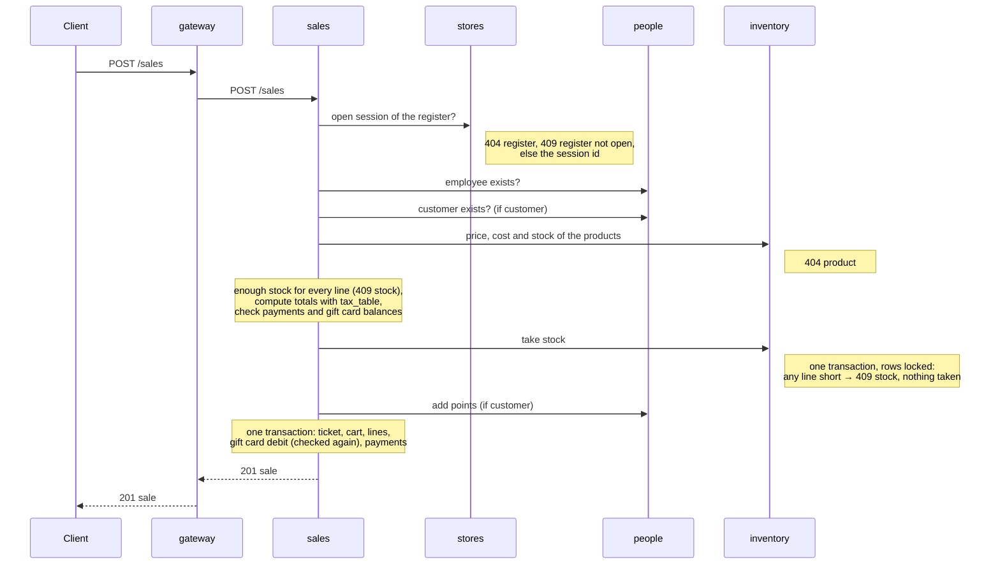

#### Look up a sale

Use case: show a past sale (receipt) with its lines and payments. Endpoint
`GET /sales/{id}`. A sale stores only its register session
(`ticket_system.register_id`); sales asks stores for the register number of
that session on every read.

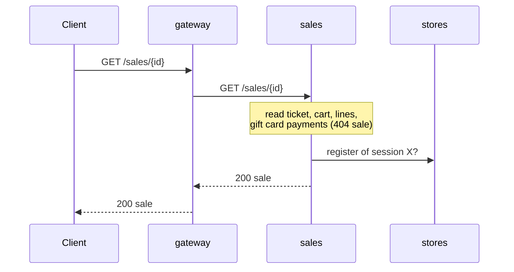

#### Return

Use case: a customer brings back products of an earlier sale at an open
register (not necessarily the register of the sale) and gets a cash refund.
Endpoint `POST /returns`.

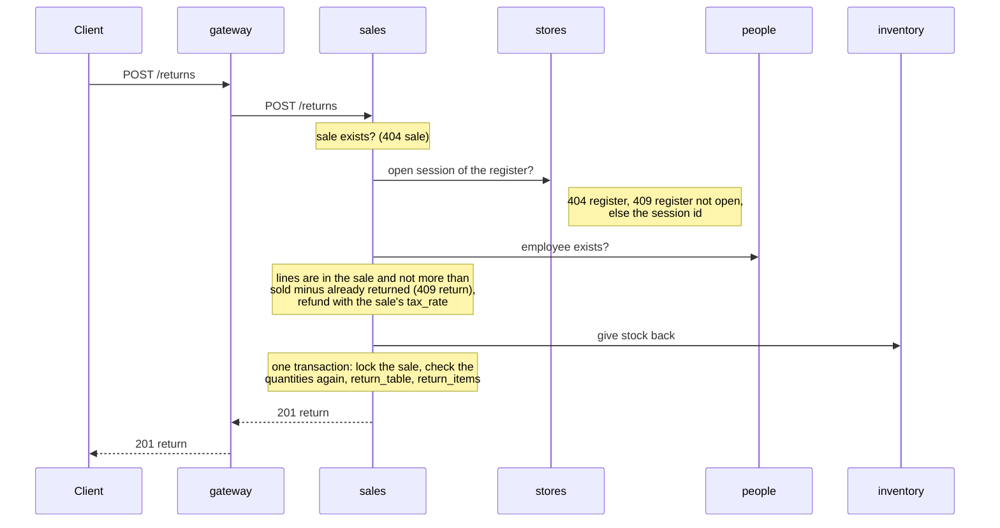

#### Open a register

Use case: an employee opens a register session with a cash float at the
start of a shift. Endpoint `POST /registers/{r}/open`.

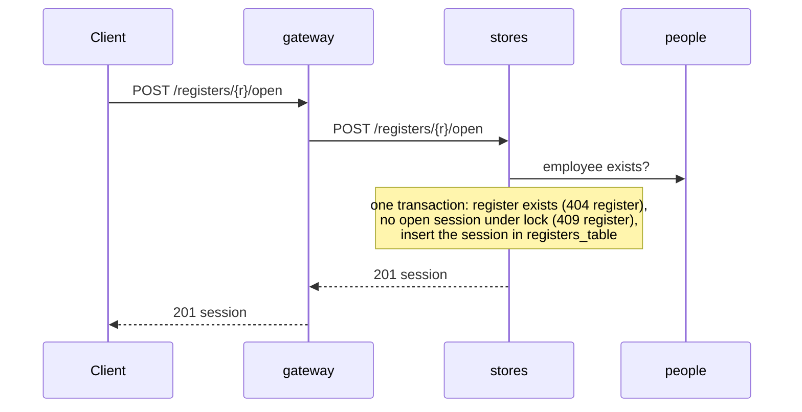

#### Close a register (Z-report)

Use case: an employee closes the register session at the end of a shift,
enters the counted cash and gets the Z-report. Endpoint
`POST /registers/{r}/close`.

Stores closes the session **before** it asks sales for the totals. From that
moment a new sale or return at this register gets `409 register`, so the
totals no longer change. This is an exception to "the leader's own write
comes last"; see "All-or-nothing".

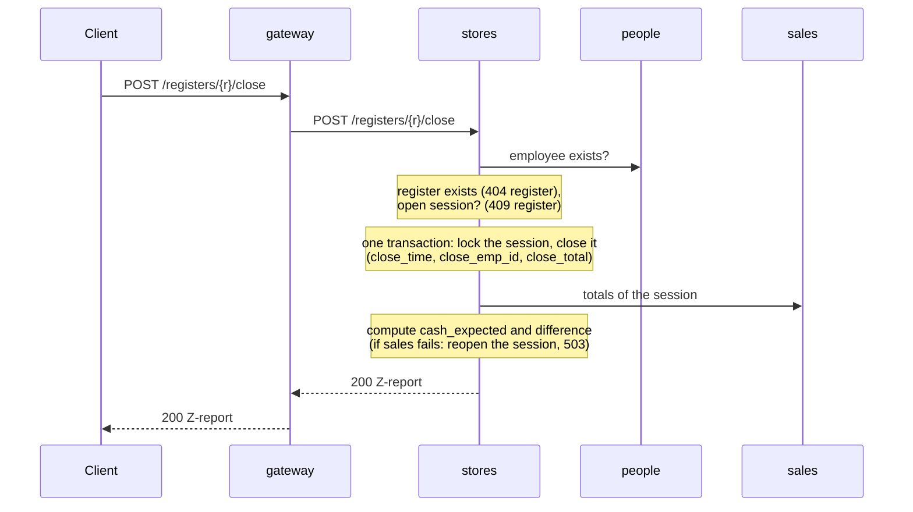

#### Create a purchase order

Use case: an employee orders products from a vendor. Endpoint
`POST /purchase-orders`.

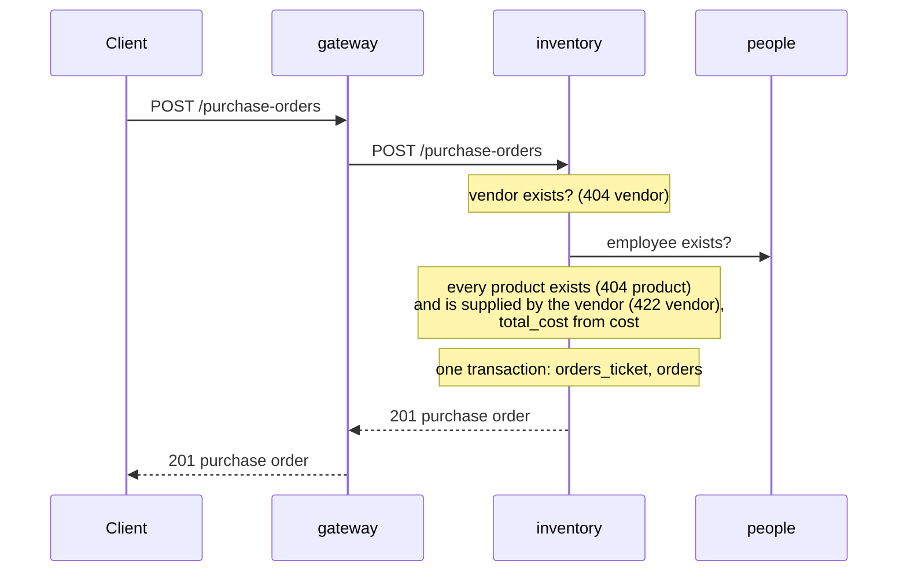

#### Goods receipt

Use case: an employee confirms that an ordered delivery arrived; the ordered
quantities go into stock. Endpoint `POST /purchase-orders/{id}/receipt`.

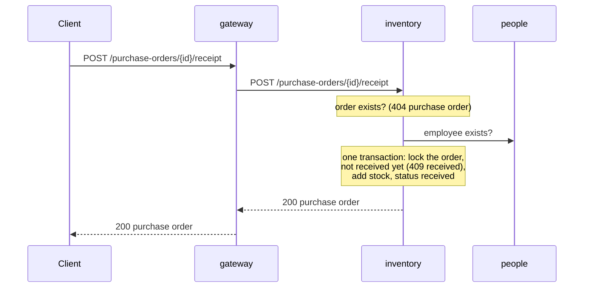

#### Sales report

Use case: the head office sees the sales, refunds and top products of one
store over a date range. Endpoint `GET /reports/sales`. Which register
sessions belong to which store is known only by stores, so sales asks for
them.

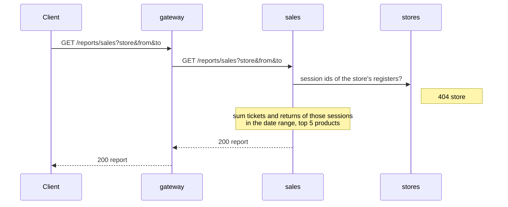

### Service APIs

The contract endpoints are served by their leader (see the use case table).
These are the internal calls between services. They follow "Conventions for
calls between services": the `X-Request-Id` header on every call, errors as
`{ "detail" }` passed on unchanged, `503` after 2 s. A call marked with a step
name changes data, writes a receipt in `applied_steps`, and is undone with
`POST /internal/undo` `{ "step": "<step name>" }`. Calls without a step only
read data; they need no receipt and no undo. If such a call fails, the leader
stops and undoes the steps done so far.

**people**

| Call | Request | Answer | Errors | Step | Used by |
|------|---------|--------|--------|------|---------|
| `GET /internal/employees/{id}` | none | `200` `{ employee_id }` | `404 employee not found` | none (read only) | sales, stores, inventory |
| `GET /internal/customers/{id}` | none | `200` `{ customer_id }` | `404 customer not found` | none (read only) | sales |
| `POST /internal/customers/{id}/points` | `{ points }` | `200` `{ customer_id, reward_points }` | `404 customer not found` | `add_points` | sales (checkout) |

The existence checks answer only the ID, so no personal data leaves people.

**inventory**

| Call | Request | Answer | Errors | Step | Used by |
|------|---------|--------|--------|------|---------|
| `GET /internal/products?ids=5,40` | none | `200` `[ { product_id, unit_price, cost, in_stock } ]` | `404 product <id> not found` | none (read only) | sales (checkout) |
| `POST /internal/stock/take` | `{ lines: [ { product_id, qty } ] }` | `200` `{ lines }` | `404 product <id> not found`, `409 not enough stock for product <id>` | `take_stock` | sales (checkout) |
| `POST /internal/stock/give-back` | `{ lines: [ { product_id, qty } ] }` | `200` `{ lines }` | `404 product <id> not found` | `give_stock_back` | sales (return) |

`/internal/stock/take` changes all lines in one transaction with the product
rows locked. Lines with the same product are added up first.

**stores**

| Call | Request | Answer | Errors | Step | Used by |
|------|---------|--------|--------|------|---------|
| `GET /internal/registers/{register}/open-session` | none | `200` `{ session_id, register }` | `404 register not found`, `409 register <r> is not open` | none (read only) | sales (checkout, return) |
| `GET /internal/sessions/{session_id}` | none | `200` `{ session_id, register }` | `404 session not found` | none (read only) | sales (look up a sale) |
| `GET /internal/stores/{SID}/sessions` | none | `200` `{ store, session_ids: [ ... ] }` | `404 store not found` | none (read only) | sales (sales report) |

`session_id` is `registers_table.register_id`; `register` is
`register_num`. `/internal/stores/{SID}/sessions` returns the sessions of all
registers of the store, open and closed.

**sales**

| Call | Request | Answer | Errors | Step | Used by |
|------|---------|--------|--------|------|---------|
| `GET /internal/sessions/{session_id}/totals` | none | `200` `{ session_id, sales_count, gross_total, tax_total, cash_sales, refunds_total }` | none: a session without sales answers zeros | none (read only) | stores (Z-report) |

### All-or-nothing

We follow the shared rule: checks first, then the writes in other services,
then the leader's own transaction. If a step fails, the earlier writes are
undone in reverse order.

- **Checkout:** sales takes stock (inventory), then adds points (people), then
  writes the sale in its own transaction. If taking stock fails or times out,
  sales undoes `take_stock`. If adding points fails or times out, sales undoes
  `add_points` and then `take_stock`. If its own transaction fails, sales
  undoes `add_points` and then `take_stock`. Inventory checks the stock again
  inside `take_stock` (shared rule "check and change in one step"), so two
  sales of the last item never both succeed.
- **Gift cards:** they belong to sales, so the debit is part of the sale's own
  transaction. The balance is checked again there under a row lock, so it
  never goes below zero.
- **Return:** sales adds the stock back (inventory), then writes the return.
  In its own transaction it locks the sale and checks the returned quantities
  again, so two returns of the same sale at the same time never return more
  than was sold. If giving the stock back fails or times out, or this check or
  its own transaction fails, sales undoes `give_stock_back`.
- **Z-report:** stores closes the session in its own transaction first, then
  asks sales for the totals. If that call fails, stores reopens the session
  (clears `close_time`, `close_emp_id`, `close_total`) and answers `503`, so
  nothing has changed. If another session of the register was opened in the
  meantime, it cannot reopen; it logs an error, as for a failed undo.
  Closing first is an exception to "the leader's own write comes last": it
  stops new sales and returns at once, so the totals cannot change while they
  are read.
- **Goods receipt:** stock and order status are both in inventory, so one
  transaction is enough.
- **Receipts:** in this variant only inventory (`take_stock`,
  `give_stock_back`) and people (`add_points`) change data on request of
  another service, so only `inventory-db` and `people-db` get the table
  `applied_steps` (see "Receipts and undo" in the common decisions). An undo
  after a timeout follows the same rule as after an error.

### Failure behaviour

| What fails | What happens | Why this is acceptable or not |
|------------|--------------|-------------------------------|
| people | No sale, return, register open or close, purchase order or receipt (the employee check fails). Customer endpoints fail. | Not acceptable for the store manager: every till stops. This is the cost of one owner per table and no copies. |
| stores | No sale, sale lookup, return, register open or close, or sales report. | Not acceptable for the store manager: sales cannot check the register session. A sale lookup fails too, because the register number of a sale is asked from stores on every read. |
| inventory | No sale, return, product lookup, purchase order or receipt. | Expected: every sale needs prices and stock. |
| sales | No sale, return, gift card, sales report or Z-report. | Expected: sales is the core of the till. |
| a sale or return runs while its register is closed | A sale or return that checked "session open" just before the close, and commits after sales has counted the totals, is missing from the Z-report. It is still stored with that session and counts in the sales report. | Known gap, accepted. It can only hit a sale that is in progress at the moment of the close (between its session check and its commit), because the session is closed before the totals are read. Closing it fully would cost every sale one more call to stores. |
| an undo fails (the owner is down when the undo is sent) | Data stays half done, for example stock taken without a sale. The service logs an error. | Known gap, accepted for this assignment. Rare, because the leader's own transaction comes last. A timeout alone no longer leaves data half done (see "Receipts and undo"). |

---

## Variant B: capability-aligned

### Services

| Service | Capability | Owns (its own model) | Copies of data from others (source, how kept current) | Store |
|---------|------------|----------------------|--------------------------------------------------------|-------|
| gateway | routing, composition | none | none | none |
| | | | | |

### Components

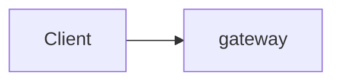

### Use case flows

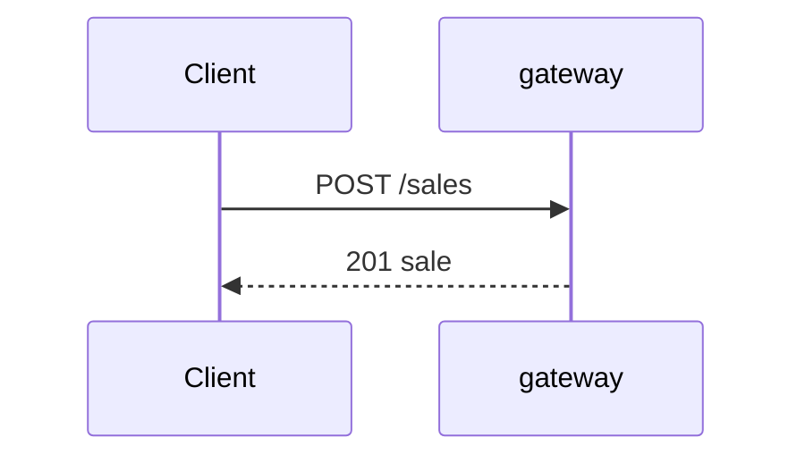

### Language

| Legacy name | Name in this variant | Service |
|-------------|----------------------|---------|
| ticket_system | | |
| | | |

### All-or-nothing

### Failure behaviour

| What fails | What happens | Why this is acceptable or not |
|------------|--------------|-------------------------------|
| | | |
