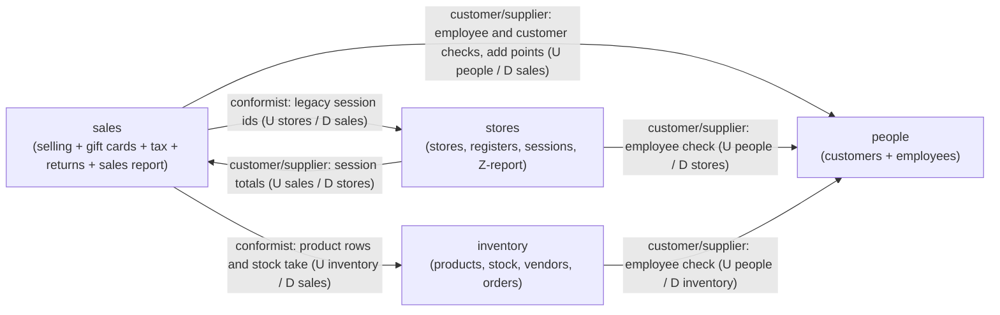
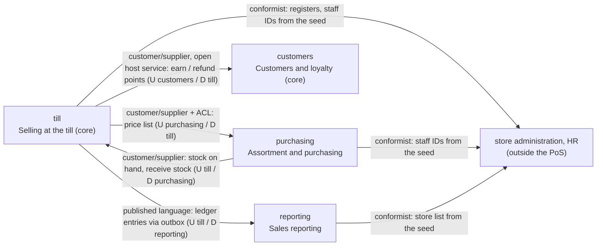

# DDD analysis

Both variants as they are, analysed with the vocabulary of Vernon, *Domain-Driven
Design Distilled*, ch. 2–4 (subdomains, bounded contexts, ubiquitous language,
context mapping) and the aggregate rules of ch. 5. It is not a third design.

Variant B is analysed from `docs/design.md` and the code in `variant-b/` at
`b-v2`. **Variant A** had no code on `main` when this was written: every
statement about A is taken from the variant A section of `docs/design.md` and is
marked *(A: design)*. The group should check these against A's code.

## Subdomains

| Subdomain | Type (core / supporting / generic) | Why | Build or buy |
|-----------|------------------------------------|-----|--------------|
| Selling at the till (checkout, payments, returns, register shifts, Z-report) | **core** | This is where Frischwerk meets its customers every day in twelve stores; the store manager's main demand ("checkout must keep working") is about it, and how fast and reliable the till is distinguishes a grocer. | build (or buy a PoS core and integrate, but the cut and the availability rules stay Frischwerk's) |
| Loyalty (reward points, tiers from CR2) | **core** | The product owner's roadmap item; tiers by 12-month spend are Frischwerk's own way to bind customers and change often (volatility). | build |
| Customer profiles (who the member is) | supporting | Needed by loyalty, but holding names and addresses is not a differentiator; it is mostly a data protection duty. | build, small (or a CRM) |
| Assortment and purchasing (product master, suppliers, purchase orders, goods receipt) | supporting | Necessary and specific to Frischwerk's suppliers, but no competitive edge. | build, or buy an ERP module |
| Sales reporting / finance ledger | supporting | Finance needs reports that reconcile to the cent; the rules are Frischwerk's, the technique is standard. | build (reports), possibly feed a bought finance system |
| Gift cards | supporting | A means of payment with one rule (balance never below zero); tightly bound to checkout. | build inside selling |
| Stock on hand | supporting | Needed by checkout and goods receipt; at a till it is a counter, not an optimisation problem. | build |
| VAT / tax rates (CR1) | **generic** | Swiss VAT is law, the same for every company: rates by category, gross prices. | buy or take from a library/tax table; only the mapping of categories is Frischwerk's |
| HR / employee management | **generic** | The PoS only needs to know that an employee ID exists; payroll, SSN and addresses are standard HR. | buy (HR system); the PoS keeps IDs only |
| Store master data (stores, registers per store) | **generic** | Reference data administered outside the PoS; no contract use case changes it. | buy / administer elsewhere |

## Ubiquitous language

Names inside variant B (`docs/design.md`, variant B, "Language"). Where a term
means different things in different B contexts, the row says so.

| Term | Meaning | Legacy name | Used in (variant B) |
|------|---------|-------------|---------------------|
| Sale | A completed checkout at one register in one shift: lines, payments, totals | `ticket_system` (+ `cart_inprogress`) | till (`sales`); in reporting the same event is a **sale entry** |
| Sale line | One product and quantity of a sale, with the unit price at the time of the sale | `item_list` | till (`sale_lines`); reporting keeps only product and quantity (`sale_entry_lines`) |
| Payment / tender | How a sale was paid: cash, card or gift card | `ticket_system.cash`, `.credit`, `ticket_gift_payment` | till (`payments`) |
| Shift | One register opened by an employee with a cash float until it is closed; the contract calls it "register session" (`session_id`) | `registers_table` | till (`shifts`) |
| Register | A till in a store | `store_registers` | till (`registers`, a copy of store master data) |
| Z-report | The closing report of one shift: sales, VAT, refunds, cash expected and counted | – (computed) | till |
| Return / refund | Products of an earlier sale brought back; the refund is paid in cash | `return_table`, `return_items` | till (`returns`, `return_lines`); in reporting a **refund entry**; in customers (v2) a **refund movement** that takes points back |
| Gift card | A prepaid card used as a tender | `gift_card` | till |
| Stock on hand | How many units of a product are in the store | `product_inventory.in_stock` | till (`stock`) |
| **Product** (purchasing) | An article of the assortment: name, brand, category, retail price, cost, supplier | `product_inventory` | purchasing (`products`) |
| **Price list entry** (till) | What the till needs of a product: its ID, its unit price and (v2) its category for VAT | `product_inventory.unit_price` (`productType`) | till (`price_list`). "Product" means two different things in purchasing and till: an assortment item vs. a price to charge. |
| Retail price / unit price | The price of one unit charged at the till; from v2 a gross price including VAT | `unit_price` | purchasing calls it retail price, till and the contract unit price |
| Supplier | A company that delivers products | `vendorinfo` | purchasing (`suppliers`; `vendor_id` in the contract) |
| Purchase order, order line, goods receipt | An order to a supplier, its lines, and the confirmation that it arrived | `orders_ticket`, `orders` | purchasing |
| **Customer** (customers) | A person with profile data (name, email, phone, address) | `customer_info` | customers |
| **Member / points account** | The loyalty side of a customer: reward points, tier, 12-month spend (v2) | `customer_info.rewards` | customers. Till only knows a `customer_id` of a member; it never sees the person. "Customer" in till means "the loyalty card shown at checkout", not the profile. |
| Tier | bronze / silver / gold by spend of the last 365 days (v2) | – (new) | customers; till stores the tier that applied to a sale |
| Staff member | An employee, known to the PoS only by ID | `employee_info` | till, purchasing (`staff`, ID only) |
| Store | A shop of Frischwerk | `stores` | till knows the store of each register; reporting keeps the store list |
| Tax rate / VAT rate | v1: one rate from the latest tax year; v2: 2.6 % or 8.1 % by category | `tax_table` | till |
| Ledger entry (sale entry, refund entry) | Finance's record of a sale or refund, used for the sales report | – (new) | reporting |

## Aggregates and invariants

| Aggregate | Invariant | Where it is enforced in A *(A: design)* | Where it is enforced in B |
|-----------|-----------|----------------------------|----------------------------|
| Stock item (stock on hand of one product) | Stock never below 0 | inventory, `POST /internal/stock/take`: one transaction, product rows locked, all lines or none; sales calls it before writing the sale | till, in the checkout transaction: stock rows `FOR UPDATE`, checked again, reduced in the same transaction as the sale |
| Gift card | Balance never below 0; several payments with one card count together | sales: debit in the sale's own transaction, balance checked again under a row lock | till: gift card rows `FOR UPDATE`, sum per card checked again and debited in the checkout transaction |
| Sale (with its payments) | Payments add up to exactly the total | sales, before any write | till, check 6 of checkout, before any write |
| Sale (with its returns) | Returned quantity ≤ sold − already returned, per product | sales: own transaction locks the sale and checks the quantities again | till: return transaction locks the sale `FOR UPDATE` and checks again |
| Shift (register session) | At most one open shift per register | stores: one transaction, "no open session under lock" | till: register row `FOR UPDATE`, then "no open shift" |
| Shift + its sales | The Z-report covers exactly the shift's sales and returns | stores closes the session first, then asks sales for the totals; **known gap**: a sale between its session check and its commit can be missing from the Z-report | till: the close locks the shift row `FOR UPDATE` and sums inside that transaction; every sale and return takes a shared lock on the shift and checks it is open. A sale is in the report or fails with `409 register`. |
| Purchase order | Received once | inventory: one transaction locks the order, checks the status, adds stock | purchasing: checked, then `receive_stock` in till, then order locked and checked again; the second of two concurrent receipts undoes its `receive_stock` |
| Purchase order | Every product is supplied by the order's vendor | inventory (products and vendors in one service) | purchasing (products and suppliers in one service) |
| Points account | Points never below 0 (v2: a return takes points back) | people *(A: design does not cover v2)* | customers, `refund_points`: removes at most the current points; the receipt stores what was removed, so the undo restores exactly that |
| Points account | Points of a request are added once, also after a timeout and a retry | people, `add_points` with receipt in `applied_steps` | customers, `earn_points` with receipt in `applied_steps` |
| Ledger (B only) | Every final sale and return appears once in the sales report | – (A computes the report from the sales tables) | till's outbox row in the sale's transaction; reporting records it with a receipt, so a repeated delivery changes nothing |

## Context map: variant A

*(A: design.)* Four contexts cut along the legacy tables. Upstream (U) is on
the left of each arrow label, downstream (D) the service that depends on it.

| Relationship | Type | Why |
|--------------|------|-----|
| sales → stores | conformist | sales stores the legacy `register_id` of stores' sessions and asks stores for their meaning on every sale, return, sale lookup and report; it has no model of its own for a shift. |
| stores → sales (Z-report totals) | customer/supplier | stores needs the totals of a session; sales supplies an endpoint made for it. The two depend on each other in both directions, which is a sign that the boundary is in the wrong place. |
| sales, stores, inventory → people | customer/supplier | every write use case checks an employee in people; people offers ID-only checks (no personal data leaves). |
| sales → inventory | conformist | sales takes the product rows (price, cost, stock) as inventory defines them, in the legacy model. |
| (all) | shared legacy model | all four keep the legacy table and column names; there is no published language, the "language" is the legacy schema. |

## Context map: variant B

| Relationship | Type | Why |
|--------------|------|-----|
| purchasing → till (price list) | customer/supplier, till with an anti-corruption layer | purchasing is upstream (it owns the product master); till translates the product into its own "price list entry" (only ID, price, v2 category) and keeps a copy, so it is independent of purchasing's model and availability. |
| till → purchasing (stock) | customer/supplier | purchasing needs stock on hand for the product lookup and must add received goods; till offers two internal calls for it. The dependency in both directions is the price of keeping stock in till. |
| customers → till (points) | customer/supplier with an open host service | customers offers `earn` (and v2 `refund`) as a small protocol in loyalty terms; till only sends a total and a date and gets points and a tier back. The loyalty rule stays upstream, which is why CR2 stayed mostly in customers. |
| till → reporting (ledger) | published language | till publishes sale and refund entries in a documented format (outbox payload); reporting builds its own ledger from them and never reads till's model. |
| till, purchasing, reporting → store administration / HR | conformist | registers, staff IDs and the store list are taken as they are from the seed; there is no use case to change them. |
| purchasing ↔ customers, purchasing ↔ reporting, customers ↔ reporting | separate ways | no relationship: these contexts never call each other. |

## What the analysis changed

Variant B was designed after the DDD lecture, so the analysis mostly checks it
instead of reshaping it. **We did not change B's cut after this analysis.**

What the analysis **confirmed** for B:

- *till* is the core subdomain "selling at the till" as one bounded context,
  and its aggregates (stock item, gift card, sale, shift) need to be changed
  together in one transaction. Keeping them in one context is why stock never
  goes below zero and why the Z-report always covers exactly the shift's sales,
  without a saga.
- The language is really different per context: "product" in purchasing vs.
  "price list entry" in till; "customer" (a person) vs. "member / points
  account" (loyalty). B models them separately; A shares the legacy names.
- Reporting as its own context with a ledger fed through a published language
  matches finance's view; the price is a copy that lags while reporting is down.

What the analysis **questions** in B:

- **Customers and loyalty in one service.** They are two subdomains of
  different kind: loyalty is core and volatile, customer profiles are
  supporting and a data protection matter. Splitting them would let loyalty
  change without touching personal data. We kept them together because the
  head of development cannot run more services and loyalty needs the customer
  ID only; a later split is cheap because loyalty already has its own calls.
- **Stock on hand inside till.** Stock is a supporting subdomain, and goods
  receipt (purchasing) has to write into till. It is in till because the
  invariant "stock never below 0" belongs to checkout's transaction. If
  Frischwerk ever manages stock across stores (transfers, replenishment), a
  separate inventory context would be needed.
- **Reference data loaded from the seed.** Registers, staff IDs and the store
  list are copies with no way to be kept current: B is conformist to contexts
  that do not exist in the PoS. That is acceptable for the assignment; in
  production, store administration and HR would need to publish changes.
- **Tax rates inside till.** VAT is a generic subdomain; in B it is code in
  till (CR1). That made CR1 cheap, but a VAT change by law now means a till
  deployment.

What the analysis says about **A** *(A: design)*:

- `sales` is a "big ball of mud" context: it mixes selling, gift cards, the tax
  table, returns and the sales report, while the register sessions it depends
  on belong to `stores`. `sales` and `stores` depend on each other in both
  directions (session checks one way, Z-report totals the other), which is why
  A has a documented gap in the Z-report.
- `people` mixes two unrelated subdomains: customers (supporting, plus
  loyalty, core) and employees (generic HR). Every use case depends on it for
  employee checks, so the generic part stops the core one.
- A's contexts follow the legacy schema, so there is no ubiquitous language of
  its own: the conformist relationships carry the legacy model across every
  boundary.
