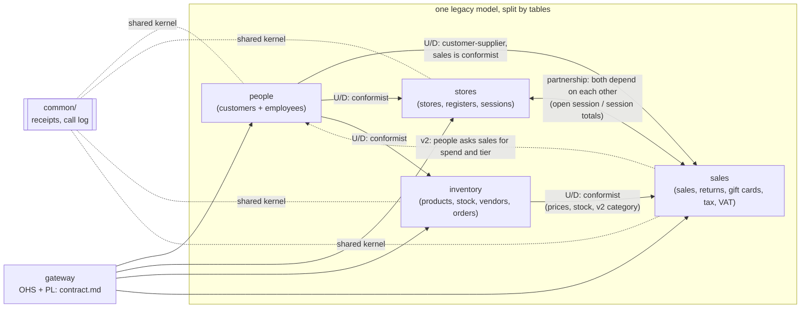
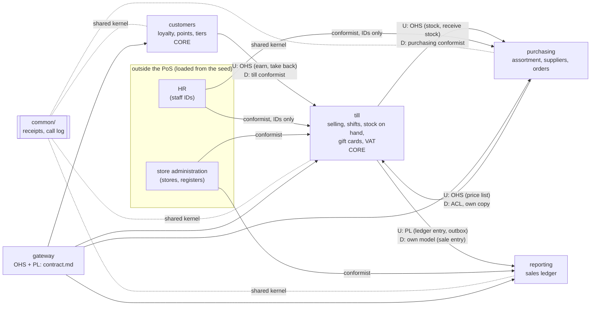

# DDD analysis

This analyses **both** variants as they are at `v2`; it is not a third
design. The terms follow Vernon, *Domain-Driven Design Distilled*, ch. 1 to 4
(bounded contexts, ubiquitous language, subdomains, context mapping) and the
short paper on integration patterns from the lecture.

## Subdomains

Frischwerk is a grocery chain. It does not make money with software, it makes
money by selling groceries and by getting customers to come back. So we asked
for every part of the PoS: does Frischwerk win anything if it is better here
than Migros, Coop or a standard PoS product?

| Subdomain | Type (core / supporting / generic) | Why |
|-----------|------------------------------------|-----|
| Selling at the till (checkout, payments, returns and refunds) | core | Every franc of revenue goes through it, and Frischwerk has adapted it for years (that is why the monolith exists). How fast and how reliable the till is, is what the customer sees in the store; the store manager's quote is exactly about this. **Build.** |
| Loyalty (customers, reward points, tiers) | core | The Product Owner puts it on the roadmap (CR2) as the way to make customers shop more. The rules (spend over 365 days, tiers, take back points on a return) are Frischwerk's own and will keep changing. **Build.** |
| Register shifts and end-of-day (open, close, Z-report, cash count) | supporting | Needed every evening in every store, and the Head of Finance wants it to reconcile to the cent. But nobody chooses a supermarket because of its Z-report. It is very close to selling, so it lives with it. **Build**, small. |
| Stock on hand | supporting | A sale must not sell what is not there, so it is needed at the till. It is not a differentiator. **Build** together with selling, because the checks are part of the sale. |
| Gift cards | supporting | Here it is a balance that is debited as a payment. Gift card platforms exist, but the balance check has to be in the same step as the sale. **Build** for now, buy later if it grows (online cards, other shops). |
| Assortment and purchasing (products, suppliers, purchase orders, goods receipt) | supporting | Head office work, specific to Frischwerk's suppliers, but standard in the industry. **Build** in this assignment, in reality a candidate for an ERP. |
| Sales reporting (ledger for finance) | supporting | Must be right, but the logic is sums and groupings. **Build** the ledger, a BI tool could do the rest. |
| Tax / Swiss VAT | generic | The rates are law and the same for every Swiss shop (CR1). There is nothing to invent, only to apply. **Buy** or take a library; in our code it is a small table. |
| Staff and HR (employee records, SSN, address) | generic | Every company has it. The PoS only needs to know that a staff ID exists. **Buy** an HR system; the legacy `employee_info` with SSNs should not be in the PoS at all. |
| Store administration (stores, registers per store) | generic | Master data that rarely changes, no contract use case changes it. **Buy** or keep as a simple list. |
| Identity and access (passwords, login) | generic | The legacy has plain-text passwords. That is a solved problem (SSO, IAM). **Buy.** Neither variant implements it, because the contract does not need it. |

Selling at the till as core is debatable: one could say a till is a commodity
and buy one. We still call it core because Frischwerk already tried a bought
PoS and ended up changing it all the time, and because the strongest
stakeholder concern (checkout must keep working) is about it.

## Ubiquitous language

The legacy names come from the US vendor and often say something else than
what they mean. The worst one: `ticket_system.register_id` is not a register,
it is the ID of a register **session** (`registers_table.register_id`). Every
time we read the monolith we had to translate this in our heads.

Variant A keeps the legacy names inside the services (rule 4 of variant A), so
this table is mainly about variant B.

| Term | Meaning | Legacy name | Used in (variant B) |
|------|---------|-------------|---------------------|
| Sale | One purchase at a till: lines, payments, total, VAT; final once it is stored | `ticket_system` (plus `cart_inprogress`, dropped) | till (`sales`); reporting has its own **sale entry**, see below |
| Sale line | One product in a sale, with qty and the price at the time of the sale | `item_list` | till |
| Payment | One tender of a sale: cash, card or gift card | `ticket_system.cash`, `.credit`, `ticket_gift_payment` | till |
| Return | Products of an earlier sale brought back, at any open register | `return_table`, `return_items` | till |
| Refund | The money paid back for a return | `return_table.refunds` | till; reporting (**refund entry**) |
| Register | A physical till of a store | `store_registers` | till |
| Shift | One opening of a register until its close; the contract calls it `session_id` | `registers_table` (and the misleading `register_id` in other tables) | till |
| Z-report | The totals of one shift at close, compared with the counted cash | none (computed) | till |
| Gift card | A prepaid balance used as a payment | `gift_card` | till |
| Stock on hand | How many pieces of a product are in stock | `product_inventory.in_stock` | till |
| Product | The master data of an article: name, category, price, cost, supplier | `product_inventory` | purchasing |
| Price list entry | Till's copy of the selling price (and in v2 the category) of a product | `product_inventory.unit_price` | till |
| Supplier | A company Frischwerk buys from; `vendor_id` in the contract | `vendorinfo` | purchasing |
| Purchase order | An order to a supplier, with order lines | `orders_ticket`, `orders` | purchasing |
| Goods receipt | Confirming that a purchase order arrived; adds the stock | `orders_ticket.status` | purchasing (leads), till (adds stock) |
| Customer | A person in the loyalty programme | `customer_info` | customers; elsewhere only `customer_id` |
| Reward points | Points earned with sales, taken back with returns | `customer_info.rewards` | customers |
| Tier, spend (v2) | bronze / silver / gold from the spend of the last 365 days | none (new) | customers (the rule); till stores the tier that applied on the sale |
| Staff member | An employee, but only as an ID | `employee_info` | till, purchasing (IDs only) |
| Store | A shop of the chain | `stores` | till (register → store), reporting (store list) |
| VAT rate (v2) | 2.6% or 8.1% by product category | `tax_table` (US tax rate, no longer used) | till |
| Sale entry, refund entry | Finance's view of a sale or a refund: what counts in the report | none (new) | reporting |

**Does a term mean the same in every service of B?** Mostly yes, and where it
does not, we used a different word on purpose:

- **Product** is the biggest split. In purchasing a product is the full master
  data with cost and supplier. In till there is no "product", only a price
  list entry and a stock line with the same `product_id`. Selling does not care
  about the supplier, and purchasing does not care what is in stock right now
  (it asks till only for the product lookup).
- **Sale** in till is the full sale with lines and payments. Reporting only
  needs store, date, total, VAT and quantities, so it is called a **sale
  entry** there. Same event, two models, which is what a bounded context is
  for.
- **Tier** is used in two places with a different role: in customers it is the
  rule, in till only a stored value ("the tier that applied"), like the price
  at the time of a sale. Till never computes a tier.
- **Store** means a full store (with its address etc.) only outside the PoS. In
  till and reporting it is just an ID.
- At the gateway the contract names stay (`session_id`, `vendor_id`,
  `register`), so the contract is a language of its own. Each service maps it
  at its edge.

## Aggregates and invariants

An aggregate is the unit that is kept consistent in one transaction. So the
interesting question for our two variants is: does each rule sit inside one
service, or does it need two?

| Aggregate | Invariant | Where it is enforced in A | Where it is enforced in B |
|-----------|-----------|----------------------------|----------------------------|
| Sale (lines, payments) | The payments add up to the total; total and VAT follow the rules (CR1, VAT per rate stored on the sale) | sales, before any write | till, before any write |
| Sale | A sale is only made at a register with an open shift | **split**: stores knows the shift, sales stores the sale. Sales asks stores first, but the shift can close before the sale commits (known gap, see design "Failure behaviour") | till, one transaction: shared lock on the shift row, checked again before the commit |
| Shift | A register has at most one open shift | stores, `store_registers` row locked `FOR UPDATE` | till, register row locked `FOR UPDATE` |
| Shift | The Z-report covers exactly the sales and returns of the shift | **split**: stores closes the shift, then asks sales for the totals; a sale in progress can be missed | till, in the close transaction with the shift row locked |
| Stock item | Stock on hand never goes below 0 | inventory, `take_stock` with the rows locked. Gap: the undo of `give_stock_back` subtracts without a check (findings A2) | till, in the sale transaction with the rows locked. Same kind of gap: the undo of `receive_stock` subtracts without a check |
| Gift card | The balance never goes below 0; several payments with one card count together | sales, in the sale transaction under a row lock | till, in the sale transaction under a row lock |
| Return | Not more of a product is returned than was sold minus already returned | sales, the sale row locked in the return transaction | till, the sale row locked in the return transaction |
| Purchase order | Every line is supplied by the order's supplier | inventory, at creation | purchasing, at creation |
| Purchase order | An order is received only once, and its stock is added only once | inventory, one transaction (order and stock in the same service) | **split**: purchasing locks the order, till adds the stock. Two receipts at once: both add stock, the loser undoes `receive_stock` |
| Points account (customer) | Points never go below 0; earned = floor(total) × rate of the tier (v2) | **split**: people keeps the balance and caps at 0, but the tier and the rate are computed in sales (v2) | customers, rule and balance in one place |
| Ledger entry | Every sale and refund is in the ledger exactly once | not needed: sales owns both the sales and the report | reporting, keyed on `sale_id` / `return_id` (findings B1) |

What this shows:

- In **A**, three rules are cut in half: the open shift, the Z-report and the
  loyalty rule. Each of them needs a call between services and either a saga
  with undo or an accepted race. The cut follows the foreign keys, but the
  foreign keys do not follow the consistency rules.
- In **B**, almost every rule that the Head of Finance and the store manager
  care about sits inside till. The one rule B cuts is the goods receipt
  (purchasing and till), which is back office and has an undo.
- The stock rule has the same small gap in both variants (undo without a
  check). It is not a boundary problem, it is the generic undo code in
  `common/`.

## Context map: variant A

Arrows go from upstream (U) to downstream (D). All four services work on the
same legacy model, cut into four pieces.

| Relationship | Type | Why |
|--------------|------|-----|
| people → sales, stores, inventory | customer-supplier, downstream conformist | Every till use case asks people "does this employee exist". There is no translation: the others use people's IDs and answers as they are. |
| inventory → sales | customer-supplier, conformist | Sales takes the prices, stock and (v2) the category in inventory's shape. |
| stores ↔ sales | partnership (in practice) | Sales asks stores for the open session and the session of a sale, stores asks sales for the session totals. Neither can change its internal API without the other. |
| people ↔ sales (v2) | partnership (in practice) | CR2 added a call from people to sales (spend and tier), so people and sales now also depend on each other. |
| common/ in all services | shared kernel | The receipts (`applied_steps`) and the call log are the same code everywhere. A change there is a change in every service. |
| gateway → clients | open host service with a published language | The contract is the published language; the gateway only routes. |

There is no anti-corruption layer anywhere in A. Every service speaks the
legacy language (`ticket_system`, `registers_table`, `register_id` that means
session). In Vernon's terms the four "contexts" are not really bounded
contexts with their own model, they are partitions of one model. The two
cycles (stores ↔ sales, people ↔ sales) are the sign of that: a clean context
map is close to a tree, and the short paper says to think about redesigning
it if the graph gets complex.

## Context map: variant B

| Relationship | Type | Why |
|--------------|------|-----|
| purchasing → till (price list) | customer-supplier; purchasing is an open host service, till has a small anti-corruption layer | Till pulls `GET /internal/price-list` and turns it into its own `price_list` copy. Till never sees cost or supplier. When purchasing is down, till keeps selling with the last copy. |
| till → purchasing (stock lookup, goods receipt) | customer-supplier, purchasing conformist | For a product lookup and a goods receipt purchasing uses till's stock API as it is. |
| purchasing ↔ till | both directions, across teams | The two calls above make purchasing and till depend on each other, and they belong to different teams (Store and Head office). This is the weakest spot of B's map, see below. |
| customers → till | customer-supplier; customers is an open host service, till is conformist | Till sends the total (v2: and the date), customers decides the points and the tier. Till just stores what it gets back. That is fine: the loyalty rule is customers' business, not till's. |
| till → reporting | published language (the ledger payload), delivered by an outbox | Reporting has its own model (sale entry, refund entry) and never calls till. Till only delivers; if reporting is down, the entries wait. |
| HR, store administration → till, purchasing, reporting | conformist (generic subdomains) | The PoS takes staff IDs and the store list as they come. Nothing to translate, and no personal data comes along. |
| common/ in all services | shared kernel | Same as in A: technical code, not business model. |
| gateway → clients | open host service with a published language | Same as in A. |

Compared to A, the map is almost a tree with till in the middle: customers and
purchasing are upstream of it, reporting is downstream. Only purchasing ↔ till
goes both ways.

## What the analysis changed

**Variant B: we did not refine the code.** `v1` and `v2` were already built and
measured when we did the analysis, and a new cut would have made `make impact`
and the blast results compare something else than what we designed. So the
findings below are written down, not implemented. What we would change, and
why:

1. **Goods receipt should not write into till.** The context map shows the only
   two-way dependency in B, between purchasing and till, which are owned by
   different teams. That works against the Head of Development's "deploy
   without waiting for each other". The refinement would be: purchasing only
   marks the order as received and publishes a "goods received" entry, and till
   pulls it and adds the stock itself (the same pattern as the price list, or an
   outbox like the ledger). Then purchasing is only upstream of till, the split
   invariant "stock is added only once" moves into till (keyed on the order ID),
   and the undo of `receive_stock` with its stock gap disappears. The price is a
   short delay before received goods can be sold.
2. **Stock on hand stays in till.** We asked ourselves whether stock should be
   its own inventory context, because "product" is split between till and
   purchasing. The aggregates say no: "never sell below 0" is part of the sale
   and is only safe in the same transaction. Moving it out would bring back the
   saga of variant A and one more container that every checkout needs (C1).
3. **Till is big, but that is on purpose.** It holds one core subdomain
   (selling) and three supporting ones (shifts, stock, gift cards). DDD allows
   one bounded context for several subdomains when the rules hold them
   together, and the invariant table shows that they do. Gift cards are the
   first thing we would split off if they ever get more logic (online, other
   shops), because their only shared rule with the sale is the balance check.
4. **The tier on the sale is ok.** At first it looked like loyalty leaking into
   till. But till only stores the value it got from customers, like the price at
   the time of a sale, and never computes it. CR2 confirms the boundary: the
   rule changed only in customers, till got a new call and one column.

**Variant A: the analysis explains what we measured.** A is not really a set of
bounded contexts: it is one legacy model and one legacy language split by
foreign keys.

- Three invariants are cut in half (open shift, Z-report, loyalty), and each of
  them costs a call, a saga or an accepted race. This is why A needs six calls
  per checkout and why checkout fails when any of 8 containers is stopped
  (`bench/results/a-v2-blast.json`), against 4 in B.
- people mixes a core subdomain (loyalty customers) with a generic one (staff
  records). Because every till use case checks the employee in people, a
  generic subdomain can stop the core one. It is good for the Data Protection
  Officer (personal data in one place), but it is the wrong reason to put them
  together.
- CR2 shows where the boundary is wrong: the loyalty rule had to go into sales,
  because the spend is computed from sales' tables, while the points stay in
  people. The rule follows the data, not the domain, and it created a second
  cycle in the context map (people ↔ sales).
- To turn A into real bounded contexts, we would have to move the shifts next
  to the sales and the loyalty rule next to the points. Then it would basically
  be variant B. So the analysis does not give us a better variant A, it gives
  us the reason why the capability cut is the better starting point.
